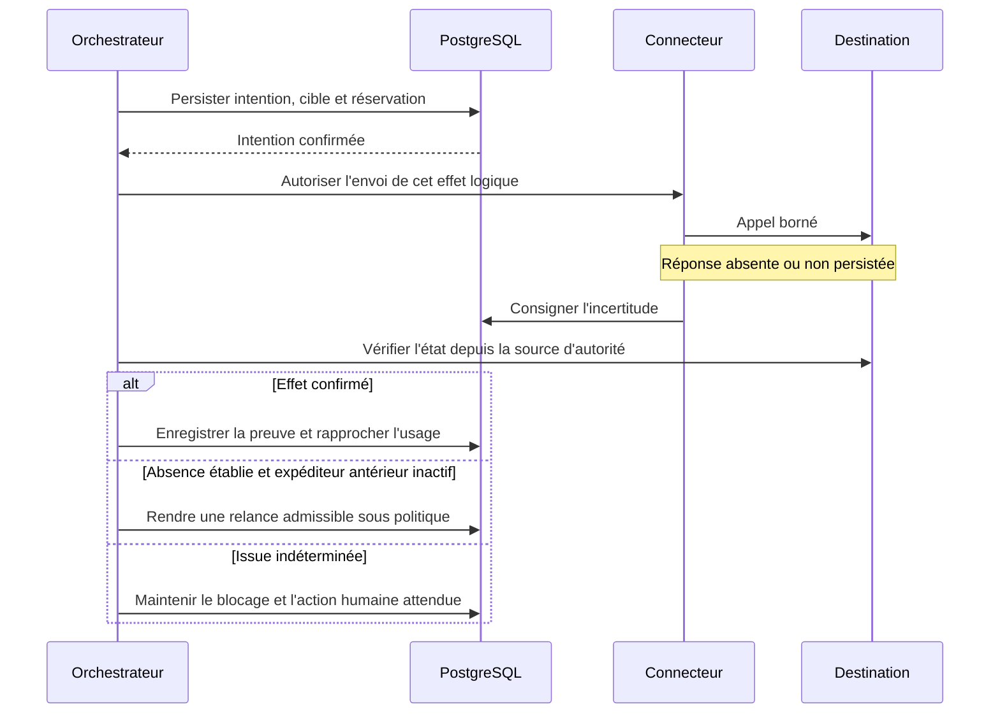

# Architecture fonctionnelle, technique et données

Proposition du 25 novembre 2026. Le dossier maître demeure la référence historique. Cette évolution rend explicites les contrats entre composants et les limites de l'atomicité.

## Périmètre produit

Le Studio gère des projets privés indépendants. Folk & Joy est le premier raccordement. GitHub demeure la source des commits, branches, issues, PR et documents du dépôt. Le Studio possède ses plans, approbations, preuves, historiques, budgets et apprentissages. Les cinq modules projettent ce même état métier. Le parcours A1 va de la sélection d'un commit à la clôture d'un rapport de qualité, sans compte IA. Les opérations répétables continuent automatiquement. Une activité non autorisée reste en attente.

## Frontières de responsabilités

| Composant | Responsabilité | Mode dégradé |
|---|---|---|
| Next.js et API | Authentification humaine, projet courant, lecture, commandes validées | Lectures dépendant de PostgreSQL indisponibles si la base est perdue |
| Core et politiques | Identité, autorisation, approbation et catalogue de profils | Refus des nouvelles capacités si les politiques ne sont pas lisibles |
| Orchestrateur | Plans versionnés, dépendances, attribution, annulation et état métier | Aucun effet ni bail nouveau si la transaction ne peut être confirmée |
| PostgreSQL | Source d'autorité des missions, du budget et des effets | Reprise et réconciliation avant réactivation |
| Worker pg-boss | Indexation, réveils, suivi des effets et notifications | Rattrapage périodique en plus des réveils déclenchés |
| Runner VPS | Tâches de confiance, sans exécuter le code candidat | Le Studio peut exposer le blocage et exploiter les autres runners |
| Superviseur PC | Exécution de builds et tests dans une VM isolée, transmission de preuves | Arrêt à l'échéance du bail, quarantaine si l'arrêt est indémontrable |
| Passerelle de modèles | Politique de données, réservation, appel, usage et réconciliation | Synthèse déterministe ou attente selon le plan |
| Volume d'artefacts | Octets immuables, vérifiés, en dehors de PostgreSQL | Rapport qualifié 'preuve absente' pour les objets non disponibles |

Next.js, worker, base et runner VPS ont des cycles d'exécution distincts dans Docker Compose. Exposer seulement le proxy TLS. Les runners passent par API. Le worker et le web réutilisent le modèle métier. Une séparation de processus ne change pas la frontière de confiance de l'hôte.

## Transactions et effets

| Moment | Écriture durable | Règle en cas de crash |
|---|---|---|
| Commande opérateur | Autorisation, clé de commande, version attendue, transition, audit, réveil | Répéter la commande avec la même clé renvoie le résultat connu. Un contenu différent sur la même clé est rejeté |
| Attribution | Étape, créneau et tentative active en une transaction, version du plan et de politique, génération, échéance | La prochaine lecture peut retrouver cette tentative. Retrouver une tentative ne réautorise pas un ancien processus |
| Remise | Artefact finalisé et vérifié, puis résultat et checkpoint référencés dans le même commit que le réveil aval | Fichier dépourvu de référence traité comme orphelin après délai. Résultat sans preuve requise exclu |
| Effet externe | Intention unique et réservation avant autorisation d'envoi, empreinte de la cible et clé distante disponible | La fenêtre entre l'envoi et le reçu durable reste ambiguë. Réconcilier avant répétition |
| Fin de mission | Rapport agrégé, verdict, écarts et état des effets | Si un effet essentiel est indéterminé, conserver un état d'attente distinct d'un succès |

Un effet a une clé métier indépendante de la tentative, une cible normalisée et une empreinte approuvée. La reprise d'un expéditeur bloque tant qu'un précédent expéditeur peut encore agir et que la destination ne sait pas repousser une opération obsolète. Éviter de déduire une absence d'effet d'une simple réponse « 404 » si la visibilité distante est décalée. Lorsqu'une destination fournit une clé d'idempotence, qualifier sa durée, sa portée et sa conduite sur un corps différent. Un effet sans preuve positive ni absence suffisamment établie reste en réconciliation. Une compensation est une action séparée, jamais un effet automatique d'une annulation.

pg-boss permet l'envoi dans la transaction de l'application. Utiliser soit cet adaptateur, soit une table d'envoi persistante si sa recette échoue. Conserver l'état métier dans les deux cas. Les commandes externes ne sont pas dans la transaction SQL. [Adaptateurs pg-boss](https://github.com/timgit/pg-boss/blob/master/docs/api/adapters.md), [verrouillage PostgreSQL](https://www.postgresql.org/docs/current/explicit-locking.html)

## Modèle de données à préciser au démarrage de la réalisation

| Agrégat | Relations et garde |
|---|---|
| Project, Membership, Repository | Toute ressource privée porte project_id. Clés étrangères composites vers le même projet. Appartenance unique utilisateur/projet |
| Mission, PlanRevision, Step, Dependency | Version active unique, plan approuvé immuable, dépendances acycliques dans une même version. Révision, auteur et motif de toute modification |
| Trigger, TriggerRun | Unicité de la règle et de l'occurrence logique. Cadence et règles de rattrapage versionnées. Déduplication indépendante du job interne |
| Agent, AgentVersion, Skill, Tool | Version et mission éventuelle de rattachement. Les métadonnées d'agent ne donnent pas de droit. Les outils gardent schéma, destination et classe d'effet |
| Runner, CapabilityGrant, Attempt | Clé technique révocable, créneau, génération par tentative et époque globale de restauration. Une tentative contrôlante par étape |
| Event, Checkpoint, Artifact | Séquence par tentative et ID de commande. Preuve immuable avec empreinte et droits de lecture. Événement tardif conservé comme observation s'il est utile |
| Approval, Effect, Reservation, Usage | Cible liée au commit et à la politique. Réservation et allocation couvrent toutes les fenêtres. Réconciliation et ajustements traçables. Une autorisation à usage unique ne s'applique qu'au même effet logique |
| DocumentVersion, KnowledgeRevision, ContextBundle | Commit ou référence de preuve, classification, portée, statut, date de revue. Paquet de contexte épinglé avec empreinte et destination |
| QualityRun, QualityEvidence, Incident, Delivery | Référentiel, commit, confiance et dérogation éventuelle. Notifications dédupliquées par incident, canal et changement pertinent |
| BackupPoint | Heure de capture, lot externe, manifestes et vérifications. Un état « vérifié » exige une preuve de lecture ou d'intégrité définie |

Index minimaux sur étapes prêtes par priorité et échéance, baux actifs par expiration, effets incertains par prochaine vérification, événements par projet/mission et curseur, et texte par GIN. Le contexte RLS est transactionnel et réinitialisé sur les connexions mutualisées. Le rôle soumis à RLS est non propriétaire et sans BYPASSRLS. L'application contrôle aussi l'accès aux objets hors de la base. [PostgreSQL RLS](https://www.postgresql.org/docs/current/ddl-rowsecurity.html), [PostgreSQL recherche](https://www.postgresql.org/docs/current/textsearch-indexes.html)

## GitHub et stockage

GitHub App en lecture seule au MVP. Permissions positives par ressource, validation de signature sur corps brut, lien dépôt-installation, accusé seulement après commit. Une livraison dédupliquée déclenche au plus un travail métier. La réconciliation paginée relit l'état courant avec limitation de débit et signale fraîcheur et accès retiré. Un événement en retard ne fait pas régresser la projection. Les écritures futures requièrent une identité séparée, une branche dédiée, une cible approuvée et un registre d'effet. Aucune écriture ni publication ne découle de la simple création d'un dépôt.

Pour un artefact, écrire d'abord en zone temporaire, valider taille et hash, publier de manière immuable, puis enregistrer sa référence. Une sauvegarde prend un dump cohérent et copie les objets référencés. Le ramasse-miettes ne peut enlever un objet référencé par une capture active. Ne pas masquer une preuve manquante derrière une prévisualisation issue d'un cache.

Sources GitHub [permissions](https://docs.github.com/en/apps/creating-github-apps/registering-a-github-app/choosing-permissions-for-a-github-app), [validation](https://docs.github.com/en/webhooks/using-webhooks/validating-webhook-deliveries), [relivraison](https://docs.github.com/en/webhooks/testing-and-troubleshooting-webhooks/redelivering-webhooks).

## Séquence de reprise après une réponse externe perdue

