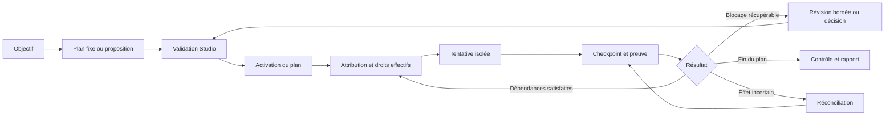

# Autonomie et architecture des agents

**Folk & Joy Studio · proposition de conception · 25 novembre 2026**

Le Studio transforme un objectif en plan borné, affecte des rôles complémentaires, enchaîne automatiquement les étapes validées et produit une synthèse vérifiable. Le coordinateur appartient au Studio. Chaque moteur IA intervient dans une tentative identifiable. Les missions, les connaissances, les contrôles et les étapes manuelles restent accessibles sans moteur IA.

## 1. Paliers d’autonomie

| Niveau | Comportement | Conditions de passage |
|---|---|---|
| A1 · Plan borné | L’humain compose ou choisit un plan versionné. Le Studio enchaîne les étapes éligibles, traite les attentes et réessaie les opérations répétables | Un parcours s’achève en mode zéro IA, après interruption et reprise, avec preuve de clôture |
| A2 · Objectif libre | Un planificateur propose une décomposition structurée, des rôles et des preuves. Le Studio contrôle le plan et le soumet à décision humaine avant activation | Schéma, catalogue, dépendances, budget et portée contrôlés. Un objectif ambigu peut déboucher sur une mission d’analyse |
| A3 · Adaptation bornée | Le Studio demande une révision des étapes futures à partir des preuves et des risques observés. Il active seul une révision à l’intérieur de l’enveloppe préapprouvée | Recette du rejet des élargissements de portée, des limites cumulées, des effets incertains et du retour à un plan exploitable |

Les parcours manuels et déterministes restent disponibles à chaque palier. Le niveau est explicite par projet et mission. Le nombre d’agents dépend des livrables et du besoin d’indépendance.

## 2. Objectif, plan et poursuite

**Objectif.** Conserver le projet, le demandeur, le résultat attendu, les sources initiales et la classification des données. Un exemple de résultat observable est une note d’impact liée à un commit ou un diff faisant passer trois contrôles nommés. Quand un dépôt, une portée, un destinataire ou un coût reste ambigu, proposer une analyse bornée ou demander une clarification avant les étapes concernées. Un texte d’objectif, une issue ou une réponse d’agent ne crée aucun droit.

**Plan.** Il comprend des nœuds identifiables, des arcs, des critères de clôture et une enveloppe. Un nœud porte ses entrées, son résultat attendu, sa compétence, ses outils candidats, son profil runner, son délai, sa limite de coût, son niveau d’effets, ses preuves et sa politique de relance. À l’activation, refuser cycles, dépendances manquantes, outils inconnus, dépassements et critères de succès manquants. Une capacité compatible hors ligne permet l’attente. Une capacité inexistante rend la proposition invalide. Une sortie ne débloque une dépendance qu’après validation du contenu, du format et de sa provenance.

| Classe | Exemple | Autorité |
|---|---|---|
| Lecture bornée | Examiner des documents autorisés | Politiques actives du projet et de la tentative |
| Calcul isolé | Construire un patch ou exécuter un test en VM | Profil du runner, périmètre local et limites de ressources |
| Engagement externe | Appel IA facturé ou future écriture GitHub | Passerelle, clé d’opération, autorisation adaptée. GitHub est en lecture seule au MVP |
| Action sensible | Publication de candidat, dérogation qualité, transfert hors périmètre initial | Approbation humaine liée à l’action et à son empreinte. Les secrets de production restent hors runner |

**Poursuite.** Une transaction valide le résultat, le checkpoint, l’événement et le signal de poursuite. L’orchestrateur actualise les dépendances. Un balayage périodique retrouve étapes prêtes, délais échus, baux expirés et signaux manquants. Les jobs de file transportent des références. Leur répétition ne crée pas de tentative supplémentaire. Vérifier le rollback commun de la transaction métier et de l’insertion pg-boss. [Transactions pg-boss](https://github.com/timgit/pg-boss/blob/master/docs/api/adapters.md)

**Clôture.** Le Studio vérifie les étapes obligatoires, les preuves, l’arrêt des tentatives de contrôle et le traitement explicite des effets incertains. Quand la date butoir est dépassée, il arrête d’attribuer et rend l’état des livrables. Un effet non déterminé garde son statut et peut demander une décision avant clôture. Le rapport expose le commit, les versions, le coût connu ou réservé et les preuves. Le raisonnement interne d’un moteur peut être inaccessible.

## 3. Progrès mesurable, révision et reprise

**Enveloppe pilote, à tester.** Une mission A2/A3 peut commencer avec 8 étapes au total, 2 tentatives par étape, 1 proposition de révision, 2 alternatives moteur par étape, 2 branches parallèles, 60 minutes de calcul cumulé et une échéance calendaire de 24 heures. Fixer aussi un nombre maximal de tours modèle et d’appels d’outils par tentative, y compris pour un moteur local. Les plafonds de jetons et de coût s’appliquent par appel. Les compteurs traversent les versions de plan. Une proposition de révision refusée compte dans le plafond. Chaque attente humaine, runner ou quota a un motif et une échéance. Les seuils sont des hypothèses de test, révisables par profil après mesure.

Un progrès correspond à un livrable accepté, une preuve requise ou la résolution vérifiable d’un blocage. Les fragments de texte et les heartbeats signalent l’activité technique. Ils n’étendent aucun délai. Deux échecs équivalents sur les mêmes entrées et la même stratégie déclenchent une suspension, même si la politique permet davantage de tentatives. Le dernier checkpoint, la cause et l’action envisageable restent visibles.

**Révision A3.** Modifier uniquement des étapes futures. Comparer l’empreinte du plan actif et des checkpoints avant activation, conserver les résultats validés et réévaluer toutes les gardes. Une baisse du seuil qualité, un budget supplémentaire, une nouvelle destination, un dépôt ou outil hors enveloppe renvoie à l’humain. Une nouvelle stratégie compatible peut remplacer une étape bloquée sans effacer son historique. Le remplacement conserve l’identifiant logique et les compteurs de l’étape. Toute étape ajoutée compte dans le plafond global, y compris après un changement de plan. Si la révision est refusée et que le plan précédent reste valide, le Studio peut le conserver.

| Incident | Réaction |
|---|---|
| Échec transitoire avant émission prouvée | Relance différée et bornée selon échéance et budget |
| Réponse externe incertaine | Garder la retenue et réconcilier à l’aide d’une clé métier indépendante des tentatives. Bloquer toute répétition avant résolution |
| Perte du runner | Refuser les mutations de l’ancienne génération. Une relance de calcul isolé et répétable peut utiliser le checkpoint. Pour une ressource exclusive, attendre la preuve d’arrêt ou réconcilier |
| Changement de moteur | Nouvelle tentative, même identité d’agent, contexte interne revu selon la politique actuelle. Session native facultative. Nouvelle approbation si les données ou contraintes l’exigent |
| Défaut qualité vérifié | Proposer un nouveau candidat soumis au même référentiel ou arrêter avec preuve. Ne pas affaiblir le seuil ni effacer le défaut d’origine |
| Révocation ou annulation | Fermer l’admission, interrompre le calcul, distinguer arrêt confirmé et effets engagés. Une compensation requiert sa propre autorisation |

## 4. Équipes et délégation

| Rôle | Production | Séparation |
|---|---|---|
| Coordinateur Studio | Validité du plan, attribution, droits effectifs et décisions | Service déterministe journalisé |
| Planificateur | Proposition structurée avec dépendances, motivation des rôles, preuves, coûts et risques | Aucun droit d’activation |
| Spécialiste | Produit un patch, une analyse ou une synthèse bornée | Identité stable, outils et sources attribués |
| Relecteur | Vérifie les preuves et signale les désaccords | Identité et environnement distincts de l’auteur |
| Responsable humain | Autorise les actions sensibles, arbitre conflits et dérogations | Décision liée à l’empreinte précise du candidat et de l’action |

**Constitution dynamique.** Pour chaque rôle requis, filtrer droit et confidentialité, indépendance auteur/relecteur, compétences et moteur qualifié, capacité runner, coût et échéance. Retenir le plus petit ensemble admissible. Classer les candidats selon preuves de compétence, disponibilité et coût compatible. Une compétence durable est une version approuvée du catalogue. Un agent temporaire reçoit une portée de mission, une durée et un profil épinglé. Sa proposition de délégation est évaluée comme une nouvelle étape. Aucun prêt de jeton ou d’autorité entre agents.

**Collaboration.** Les messages inter-agents sont des livrables typés. Ils portent conclusion, références, classification, limites et question ciblée. Ils ne transforment en entrée que les résultats validés. Une question non bloquante peut être close avec un risque déclaré. Une discussion libre sans critère de progression ne relève pas de l’automatisation.

- **Incident.** Collecteur déterministe, spécialiste qui sépare observations et hypothèses, relecteur qui vérifie la chronologie, coordinateur qui synthétise les preuves et les limites.
- **Modification future.** Planificateur, auteur en VM, contrôle indépendant sur le commit candidat et rapport pour décision humaine. Le verdict appartient au Quality Lab. Le synthétiseur expose les constats sans modifier le verdict.

## 5. Concurrence et effets

**Admission.** Combiner plafond global et créneaux par projet et profil. Attribuer un tour aux projets éligibles, puis distribuer le surplus selon poids, priorité et ancienneté. Le vieillissement empêche la famine lorsque la capacité revient. Une priorité n’interrompt pas un effet externe actif. Conserver au départ un créneau unique pour les travaux lourds du PC. Mesurer deux projets à charge égale et un projet très bavard.

**Conflits de code.** Figer la base Git et les chemins pressentis. Bloquer les chevauchements connus au premier incrément. Chaque tentative admise écrit dans un espace propre. Un worktree facilite la séparation des arbres dans le même périmètre de confiance. Une VM ou un clone isolé matérialise la séparation entre processus de confiance différente. Comparer les diffs réellement produits. L’assemblage crée un nouveau candidat qui repasse la recette et les approbations. Collision de fichier, changement de base ou conflit sémantique déclenche une revue. [Git worktree](https://git-scm.com/docs/git-worktree), [Git merge-tree](https://git-scm.com/docs/git-merge-tree)

**Publication future.** Une écriture active par dépôt et référence. Vérifier la tête attendue avant l’effet. Enregistrer l’intention et son identifiant stable avant l’appel. Après perte de réponse, chercher les indices faisant autorité avant répétition. Un effet confirmé après demande d’arrêt reste enregistré. Lors d’une restauration, isoler l’ancien hôte, invalider les baux précédents et rapprocher les opérations externes avant la reprise des écritures.

## 6. Comparatif d’orchestration

| Solution | Capacités documentées | Exploitation et recommandation |
|---|---|---|
| PostgreSQL et pg-boss | File persistante, planification, insertion transactionnelle et travailleurs | Dépendance libre sur la base déjà choisie. Les politiques, transitions et garanties métier restent au Studio. Recommandé A1 à A3 avec contrat de file remplaçable. [pg-boss](https://github.com/timgit/pg-boss) |
| Temporal | Historique de workflow, reprise, activités et retries. Une activité à effets doit tolérer la répétition | Serveur libre MIT ou offre hébergée. Service et historique supplémentaires à exploiter. À réexaminer si les workflows de longue durée excèdent le modèle opérationnel du Studio. [Workflows](https://docs.temporal.io/workflows), [activités](https://docs.temporal.io/activity-definition), [licence](https://github.com/temporalio/temporal/blob/main/LICENSE) |
| LangGraph.js | Checkpoints de graphe, reprise et interruptions. Les effets précédant une interruption demandent une sémantique de relance sûre | Noyau MIT. Candidat à l’intérieur d’une tentative de planification bornée. La persistance de mission et l’autorité restent au Studio. [Persistance](https://docs.langchain.com/oss/javascript/langgraph/persistence), [interruptions](https://docs.langchain.com/oss/javascript/langgraph/interrupts), [licence](https://github.com/langchain-ai/langgraphjs/blob/main/libs/langgraph/LICENSE) |
| OpenAI Agents SDK | Composition, délégation, garde-fous et traces | SDK MIT. Le coût des modèles et l’autorisation des exports sont à traiter séparément. Candidat comme outil de tentative et non comme gouvernance métier. [Orchestration](https://openai.github.io/openai-agents-js/guides/multi-agent/), [traces](https://openai.github.io/openai-agents-js/guides/tracing/), [licence](https://github.com/openai/openai-agents-js/blob/main/LICENSE) |

Les capacités sont documentaires. Les comptes, prix d’offres hébergées optionnelles et environnements exécutables restent à qualifier avant adoption.

## 7. Recette ciblée

| Test | Résultat attendu |
|---|---|
| Cycle ou outil inconnu dans une proposition | Refus avant activation, avec nœud, règle et politique |
| Parent accepté, crash avant progression | Résultat unique. Enfants éligibles retrouvés par balayage |
| Activité textuelle continue et échecs identiques | Suspension à la limite, sans extension d’échéance ou de budget |
| A3 demande plus de droits | Refus et action humaine précise. Compteurs et preuves préservés |
| Agent temporaire expiré en exécution | Fermeture des droits. Résultat tardif inapte à modifier la mission |
| Deux projets de même classe et soumissions inégales | Admission équitable, limites globales respectées, attente explicite |
| Deux diffs touchent un même fichier inattendu | Assemblage interrompu, diffs et preuves inspectables |
| Bascule vers un moteur moins fiable ou une destination interdite | Aucun appel. Motif de non-admission et checkpoint visibles |
| Contrôle obligatoire indisponible | Aucun verdict positif. Le rapport donne l’état et le risque restant |

Le contrat de contexte, de provenance et d’apprentissage est défini dans [Mémoire et apprentissage](03-memoire-et-apprentissage.md). Les seuils, les profils de délégation et les actes imposant deux personnes restent soumis au propriétaire.

**Vérification conceptuelle exécutée.** Une énumération locale de 243 suites de cinq choix parmi trois stratégies a vérifié que le modèle d’une lignée d’étape conserve un maximum de deux tentatives et d’une révision admise. Elle porte sur un prédicat abstrait, sans exécution concurrente, runner ou implémentation du Studio.
