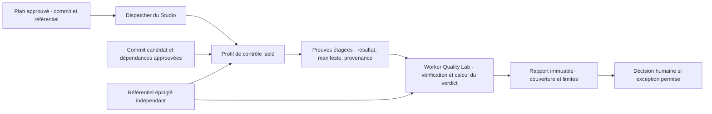

# 06 — Quality Lab, observabilité et incidents

**Dossier intégral de conception · 25 novembre 2026 · Proposition soumise au propriétaire**

Ce document définit comment le Studio vérifie un résultat, mesure son propre fonctionnement et rend un incident explicable. Les parcours déterministes et les simulations sont réalisables sans IA. Les profils de contrôle propres à Folk & Joy dépendent de l'inventaire de son dépôt, de sa CI et de ses droits effectifs.

## Quality Lab

### Périmètre de décision

Le référentiel qualité épinglé énumère les contrôles, les preuves attendues, les conditions d'applicabilité, les seuils et les règles de passage. Une version approuvée s'applique à un plan déjà figé. Le commit candidat peut contenir ses propres tests et fournir des résultats utiles. Le service de décision choisit ses critères indépendamment du commit et de l'identité qui l'a produit. Il distingue l'absence d'une preuve, un échec mesuré et une régression confirmée.

| Élément | Propriétaire | Contraintes |
|---|---|---|
| Référentiel | Responsable qualité habilité | Version immuable après publication. Source et empreinte épinglées dans le plan. Modification et validation séparées de la mission candidate |
| Candidat | Auteur humain ou agent de développement | Accès à son espace isolé. Livrable identifié par commit ou patch vérifiable. Aucun accès aux clés, décisions ou attestations du Quality Lab |
| Exécution d'un contrôle | Runner de confiance pour analyse déterministe passive, environnement jetable pour compilation et tests du candidat | Profil et version approuvés, entrée vérifiée, limites de ressources, aucun secret de production, réseau selon politique |
| Preuve primaire | Processus de contrôle et superviseur identifiés | Résultat typé, empreinte de sortie, conditions de mesure, horodatage serveur, lien à la tentative et au bail |
| Verdict | Worker Quality Lab, à partir du manifeste approuvé et des résultats enregistrés | Recalcule le passage et publie un rapport immuable. Toute nouvelle interprétation référence la version précédente |
| Exception | Approbateur autorisé selon politique du projet | Motif, risque, cible, contrôle, résultat et expiration. Les contrôles non dérogeables restent bloquants |

**Frontière de confiance.** Le programme candidat ne possède ni le jeton du superviseur ni le droit de réduire les critères. Les tests isolés reçoivent leur spécification depuis un canal protégé. La lecture des données du candidat et l'exécution du code candidat utilisent des profils séparés. Un runner PC compromis peut fournir de fausses preuves. Un échec de qualification, une dérive de version ou une attestation incohérente dégrade la confiance du rapport. Un contrôle critique peut demander une réplication indépendante ou une preuve issue d'une CI déjà reconnue. Une signature issue d'un hôte compromis ne rétablit pas la confiance dans l'exécution. Le modèle s'inspire des relations entre source, environnement et résultat de la provenance SLSA. Aucun niveau SLSA n'est revendiqué. [Provenance SLSA](https://slsa.dev/spec/v1.2/provenance)

### Contrôles et preuves

| Famille | MVP et dépendances | Éléments d'acceptation |
|---|---|---|
| Unitaire et intégration | Exploiter les tests identifiés et une base de données jetable. Séparer les suites du candidat et les suites contrôlées par le référentiel | Nombre prévu, exécuté, ignoré et échoué. Version de l'image, commit, profil et cible. Un résultat vide doit être expliqué |
| Régression | Comparer à une référence marquée du même projet. Fixer environnement, version de suite, dépendances et échantillon | Montrer la différence, la métrique et l'écart observé. Si les conditions diffèrent de façon matérielle, marquer « Comparaison non établie » |
| Sécurité défensive | Vérifier droits, paramètres et dépendances de façon déterministe et suivre une sélection documentée du référentiel ASVS. Paramétrer les sources de données autorisées | Rapport avec version du référentiel, groupes de contrôles, preuves et résultats en attente de qualification. Aucun verdict de certification globale. [OWASP ASVS](https://owasp.org/projects/asvs/) |
| RLS et autorisations | Couvrir acteur permis, acteur refusé, groupe sans appartenance, rôle de service et cas anonymes. Vérifier lectures, insertions, mises à jour et suppressions sur fixtures de deux projets | Préciser l'identité PostgreSQL effective, tables, opérations et résultats. Couvrir les bypass implicites d'un rôle propriétaire ou muni de droits élevés, et la réutilisation d'une connexion. [Sécurité par ligne PostgreSQL](https://www.postgresql.org/docs/current/ddl-rowsecurity.html) |
| Migrations | Répéter en base jetable à partir d'un état représentatif de la version précédente, avec données synthétiques ou copie autorisée et protégée. Contrôler intégrité et durée des verrous | Relier version initiale, empreinte de migration et version finale. Documenter vérifications et stratégie de retour ou reprise pour une transformation irréversible |
| Dépendances | Relier alertes et dépendances verrouillées à une source de données datée. Vérifier que la collecte est encore fraîche | État par composant et version, pertinence au profil, preuve, exception et échéance. Les résultats périmés sont visibles |
| Architecture | Contrôler les frontières de modules, dépendances autorisées et relations de données sensibles au moyen de règles versionnées | Violations identifiables, chemins restreints ou imposés, version du référentiel, attribution à un responsable |
| Performance | Mesures sur parcours et jeu de données fixes, avec percentiles et plafond relatif à une référence. Fixer la concurrence observée et l'état des caches | Reproductibilité et marge d'incertitude. Une mesure locale ne garantit pas les performances de la production |

**Résultats et passage.** Un contrôle sépare son résultat factuel et le niveau métier du constat. Les résultats factuels couvrent succès, échec, preuve insuffisante, non exécuté et non applicable motivé. Les appréciations couvrent bloquant, correction nécessaire, informatif et non vérifié. Le passage est refusé si un contrôle obligatoire échoue ou reste non vérifié, sauf exception en vigueur lorsque la politique l'autorise. Deux rapports sur le même commit et le même profil restent lisibles s'ils divergent. Un contrôle instable appelle qualification et signalement. Il ne disparaît pas de la couverture après une relance favorable.

**Manifeste de preuve.** Inclure projet, dépôt et commit, plan, tentative, identifiant/version du contrôle, identité et version du runner, environnement et versions d'outils, entrées non sensibles et leurs empreintes, heure serveur et durée mesurée, code de résultat, couverture, observations, artefacts et empreintes. Les sorties des outils du candidat sont traitées comme non fiables, limitées et purgées de données sensibles avant mise à disposition. Le stockage d’artefacts valide l'objet avec son manifeste avant mise en ligne. Les utilisateurs voient la provenance et la rétention prévue. Un rapport dont la preuve a expiré l'indique explicitement.

### Déclenchement et indépendance du passage

- **À la demande.** Un opérateur lance un profil autorisé sur un commit explicitement choisi, avec plafonds de durée, taille, concurrence et budget.
- **Périodique.** Un profil de maintenance déjà autorisé déclenche un audit des dépendances ou du commit de référence. Un verrou par projet, profil et cible empêche l'accumulation de copies. Un changement des règles ou de la destination des preuves impose une nouvelle autorisation.
- **Sur événement.** Une mise à jour GitHub peut planifier une vérification préautorisée avec temporisation si plusieurs commits arrivent rapprochés. L'identité du commit demeure dans le rapport. Seul le résultat du commit effectivement examiné peut lui être associé.
- **Intégration GitHub.** Au MVP, le Studio lit la CI autorisée et expose ses propres rapports dans le Studio. Une future publication de statut doit utiliser une App limitée qui ne fusionne ni ne déploie. Vérifier les droits réels du dépôt et les règles GitHub avant d'utiliser un check comme condition requise. Le Quality Lab ne revendique aucun statut de garde de production tant que son effet réel n'a pas été testé. [GitHub Check Runs](https://docs.github.com/en/rest/checks/runs), [branches protégées GitHub](https://docs.github.com/en/repositories/configuring-branches-and-merges-in-your-repository/managing-protected-branches/about-protected-branches)

## Observabilité opérationnelle

### Signaux et droits

| Signal | Usage | Source et visibilité |
|---|---|---|
| Événement métier | Reconstruire mission, décision et effet à partir d'un état durable | PostgreSQL. Filtré par projet et rôle. Donne l'horodatage serveur et l'état de traitement |
| Journal technique | Diagnostiquer réseau, erreurs API, pool DB, workers et projections | Structuré et limité. Réservé à l'exploitant autorisé. Les détails privés restent classifiés et soumis au périmètre de l'incident |
| Audit | Prouver les décisions, accès sensibles, révocations et éventuelles exceptions | Écriture append-only pour les rôles applicatifs. Aperçu projet selon droit, vue globale réservée et export séparé |
| Mesure agrégée | Suivre santé, saturation, latence, erreurs et marge restante | Collecte légère, agrégation par service, classe d'erreur et type d'opération. Les identifiants uniques restent dans l'événement ou la trace |
| Trace corrélée | Relier API, worker, runner, contrôle et fournisseur | Contexte généré et validé par le Studio aux frontières de confiance. Résolveur de trace soumis aux mêmes droits que l'objet |

L'enveloppe d'événement propose version de schéma, identifiant, projet éventuel, corrélation, parent causal, acteur technique, mission, étape, tentative, type, source, heure serveur, heure de source si utile, catégorie de visibilité et résultat. Les événements validés et les effets à réconcilier alimentent les projections. Les journaux du runner et du fournisseur peuvent arriver tard. Le Studio conserve l'observation en distinguant son heure d'occurrence et de réception. Une projection ne peut appliquer une ancienne génération à un bail actuel.

Le tableau de bord explique **ce qui s'est passé et sur quelle base** par le plan, la règle appliquée, l'outil, le contexte observable, les données d'entrée autorisées, les délais, les coûts mesurés et le résultat. Les pensées internes d'un modèle ne font pas partie du contrat de télémétrie. Les prompts complets, contenus privés, jetons, en-têtes d’authentification et arguments non filtrés restent absents des métriques et journaux techniques. Préférer les références et empreintes. De façon initiale, conserver les journaux diagnostiques 14 jours sous quota. Les décisions et preuves métier suivent leur propre rétention. [OpenTelemetry, signaux](https://opentelemetry.io/docs/concepts/signals/), [propagation du contexte et confidentialité](https://opentelemetry.io/docs/concepts/context-propagation/), [cardinalité des métriques](https://opentelemetry.io/docs/concepts/signals/metrics/)

### Tableau de bord, seuils initiaux et réactions

Ces seuils orientent la recette. Ils décrivent les symptômes observables. Confirmer les fenêtres de déclenchement et de retour à la normale sur le volume réel.

| Source | Mesures clés | Réaction de départ |
|---|---|---|
| Proxy, application, TLS | Disponibilité publique, latence, p95, taux 5xx, échéance TLS, dernière mesure | À partir de deux échecs consécutifs depuis une sonde hors hôte, ouvrir une alerte de disponibilité. Voir si l'incident touche accès public, application ou base |
| VPS | CPU, RAM, redémarrages, volume, I/O et marge de sauvegarde | Alerte disque à 70 %. Suspendre les nouvelles tâches qui accroissent les artefacts à 85 %. Réserver une marge pour audit, écritures métier et restauration |
| PostgreSQL et pool | Accessibilité, saturation des connexions, attentes, transactions anormalement longues et taille | Une perte durable produit un incident. Refuser les mutations sans accusé durable. Après retour, mesurer le délai de reprise et la taille de file |
| File et missions | Nombre prêt et bloqué, âge du plus ancien travail éligible, échéances, âge des tentatives incertaines | Distinguer absence de créneau et absence d'autorisation. Alerter sur un travail prêt prolongé alors qu'une capacité saine et compatible est libre |
| Runner et Agent Office | Dernière présence, génération active, capacité, refus d'attribution et preuve d'arrêt | PC offline prévu affiché en information. Incident si perte de bail d'une tentative risquée, arrêt incertain ou échéance dépassée |
| Fournisseur et moteur | Disponibilité observée, codes d'erreur, quotas, latence, version qualifiée, basculements | Filtrer erreurs d'accès, quotas et panne. Suspendre les profils incompatibles. Afficher pourquoi un moteur demeure inéligible |
| Budget | Plafond, réservations ouvertes et âgées, estimation, coût confirmé, écart de rapprochement | Suspendre les engagements selon la politique. Incident sur un écart inexpliqué ou achat que le Studio ne peut attribuer |
| GitHub | Livraison acceptée/rejetée, âge de dernière réconciliation, saturation API et ressources inaccessibles | En cas de retard, afficher « Données périmées ». Une installation révoquée déclenche une alerte et suspend les étapes qui exigent une donnée fraîche |
| Quality Lab | Profils, résultats insuffisants, version de référentiel, durée, dernier rapport exploitable | Transformer une régression obligatoire en motif de blocage. Agréger les résultats répétés du même commit avant notification |
| Sauvegarde | Âge du dernier point exploitable, résultat de vérification, exercice de restauration le plus récent | Alerter à 18 h sans point utilisable pour protéger l'objectif de 24 h. En cas d'échecs répétés, ouvrir incident et signaler l'écart de RPO |

**Infrastructure de mesure.** Le MVP utilise journaux structurés, métriques locales bornées, états en PostgreSQL et une sonde extérieure simple. Dès la recette, séparer la voie de détection d'une perte complète du VPS de l'application qu'elle contrôle. Un service existant autorisé ou un poste indépendant en ligne peut la fournir. Un PC éteint ne constitue pas une source continue de mesure. Sans sonde indépendante qualifiée, le Studio expose cette couverture manquante. Une instrumentation OpenTelemetry exportable suit la croissance des besoins de corrélation. Prometheus et Alertmanager deviennent intéressants avec une rétention et des règles d'alerte plus riches. Éviter de rendre obligatoires un collecteur, un tableau de bord ou un abonnement externe pour faire tourner les missions. [Bonnes pratiques Prometheus d'instrumentation](https://prometheus.io/docs/practices/instrumentation/), [conception des alertes](https://prometheus.io/docs/practices/alerting/), [Alertmanager](https://prometheus.io/docs/alerting/latest/alertmanager/)

## Gestion des incidents et notifications

**Cycle.** Détecté → ouvert → reconnu → en traitement → résolu → revu si impact. Un incident garde sa sévérité, sa cause probable révisable, son service ou projet, son propriétaire, les périodes observées, les décisions et les preuves. Le retour à une mesure saine clôt l'alerte technique selon sa fenêtre de stabilité. La clôture métier exige la résolution des effets à réconcilier, l'issue de la tentative et l'état du budget. Un nouvel incident ou une réouverture se déduit d'une clé stable incluant portée, règle et ressource bornée.

**Notification.** Émettre d'abord dans le Studio, puis vers un canal externe explicitement autorisé. La charge externe porte sévérité, symptôme, heure, incident et lien. Aucun secret, extrait de code ou artefact privé ne part par défaut. Un échec de livraison conserve sa preuve et applique un nombre borné de reprises espacées. Dédupliquer par incident, politique et canal. Si le canal accepte un identifiant d'effet, l'utiliser. Un accusé absent peut laisser un doublon de message et doit rester visible. Tester une alerte externe sans dépendre du process de l'application pour couvrir la panne totale de l'hôte.

| Niveau | Exemples | Réaction et information |
|---|---|---|
| Critique | Indisponibilité généralisée, violation d'isolement confirmée, absence prolongée de sauvegarde exploitable ou dette d'effet de production | Suspendre les opérations affectées, avertir le propriétaire via le canal autorisé, préserver preuves et exiger une décision avant certaines reprises |
| Important | Rapprochement financier incohérent, réplication qualité suspecte, droits GitHub retirés ou mission à effet incertain | Bloquer la portée précise, proposer la réconciliation ou qualification et prévenir son responsable |
| Informatif | PC arrêté sans tâche urgente, contrôle d'une nouvelle version non commencé, attente d'une approbation usuelle | Afficher dans le Studio. Regrouper sur demande, sans diffusion externe automatique |

**Lecture après incident.** La chronologie relie plan, version du moteur, baux, décisions, preuves et notifications. Elle donne le dernier état confirmé et les éléments manquants. Le compte rendu durable conserve impact, cause établie ou inconnue, actions correctives, responsable et date de revue. Lorsqu'une connaissance doit être partagée hors du projet, elle suit la validation et la déclassification prévues par Project Intelligence.

## Scénarios de recette

| Scénario | Résultat observable exigé |
|---|---|
| Le candidat modifie ses tests et présente un résultat vert | Les suites et critères indépendants restent épinglés. Le rapport différencie tests du candidat et contrôles indépendants |
| L'artefact est altéré ou une preuve vient d'un runner déqualifié | Le résultat élevé au niveau du verdict est « Preuve insuffisante ». Un contrôle obligatoire bloque le passage |
| Une régression apparaît et la relance réussit | Les deux résultats restent disponibles. Le rapport explique la divergence et la décision humaine éventuelle |
| Un contrôle planifié rencontre un budget épuisé ou une capacité absente | Aucun appel interdit. Le contrôle attend ou devient non vérifié avec motif. La signature de la version de référence ne change pas |
| PostgreSQL devient indisponible pendant un traitement | Aucun succès métier sans commit. La sonde et le journal signalent l'indisponibilité. Les événements et effets sont réconciliés avant clôture |
| Le VPS est complètement arrêté | Une sonde extérieure détecte la perte sans agent du Studio. Après retour, l'incident peut être rapproché avec l'horodatage de la sonde |
| Le webhook GitHub est dupliqué puis le service est inaccessible | Une seule incidence métier. La vue devient périmée avec dernier succès et redevient fraîche après réconciliation |
| Une notification arrive sans accusé | La politique de reprises maintient la demande observable et bornée. Le Studio garde la trace de l'incertitude |
| Un lecteur hors projet tente d'ouvrir trace, rapport ou artefact | Les API, exports et vues par identifiant ne révèlent aucun détail privé. L'accès refusé est auditable par les personnes habilitées |
| Les données opérationnelles croissent lors d'une sauvegarde | Les métriques restent de cardinalité bornée, l'espace est plafonné et les décisions métier continuent à être enregistrées dans leur plage de capacité |

Les références documentaires établissent les mécanismes disponibles. La qualité des preuves, les seuils d'exploitation, l'acheminement externe et la performance du système restent à éprouver sur le profil réel.
