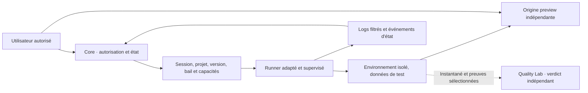

# App Lab · étude de faisabilité et contrat d'évolution

**25 novembre 2026 · recommandation.** App Lab devient une capacité de visualisation et d'interaction au niveau du projet, après le MVP A1. Son premier incrément utile est **Expo Web sur un runner local pour un projet de confiance et des données de test, ouvert sur une origine distincte du Core**, avec contexte de version et logs minimisés. Le type de projet Expo et ses modules effectifs n'ont pas été inspectés. Aucune preview, build, souscription, connexion d'appareil ou session externe n'a été lancée. Les capacités ci-dessous proviennent de sources officielles consultées le 25 novembre 2026.

## 1. Ce que l'on peut rendre et vérifier

| Environnement | Capacité documentée | Conditions réelles à qualifier | Usage proposé |
|---|---|---|---|
| Expo Web | Serveur de développement, preview navigateur interactive, rechargement rapide pour changements compatibles | Support Web des routes, bibliothèques, modules natifs et API. Toute dépendance uniquement native peut dégrader le rendu | Premier parcours local. Tester navigation et erreurs sur un commit fictif puis sur un dépôt désigné |
| Expo Go | Runtime partagé léger pour des projets compatibles avec ses modules natifs et sa version SDK | Ne peut embarquer à la demande un module natif spécifique au projet. Appareil, réseau et éventuelles contraintes de compte selon plateforme | Ouverture locale facultative pour itérer, sans verdict natif ni fiabilité de production |
| Expo Development Build | Application de développement propre au projet, avec modules natifs, reliée à Metro | Reconstruction après changement de code/configuration native. SDK natif, ABI et provenance du binaire à conserver. Le runtime connecté ne suffit pas à identifier le commit affiché | Pour Android puis iOS selon disponibilité des hôtes |
| Android Emulator | Android natif simulé avec écran et contrôles, exécutable sur un hôte compatible | Accélération à qualifier sur Windows WHPX ou Linux KVM. Hypothèse de démarrage sur hôte, sans exiger de virtualisation imbriquée. Image, API, ABI, performance et ressources influent sur la fidélité | Contrôle natif local après mesure de la valeur. Tracer les caractéristiques du périphérique virtuel |
| iOS Simulator | Build simulateur et exécution via Xcode sur macOS compatible | Machine macOS et outils adaptés. Un PC Windows ou WSL2 ne fait pas tourner le simulateur Apple localement. Simulator ne couvre pas les conditions de performance et les périphériques réels | Runner Mac existant ou session distante autorisée ultérieurement. Préserver la possibilité de l'absence d'iOS |
| Appareils physiques | Runtime réel, accès aux périphériques disponibles et contraintes d'installation spécifiques à la plateforme | Appareil dédié, consentement, clé de signature si requise. Xcode Personal Team documente des limites de provisioning de sept jours. Les builds et canaux de distribution varient | Après la preuve de valeur native et avec données fictives, jamais sur un appareil personnel pris implicitement pour runner |
| Expo Simulators | Android/iOS distants sur Expo, aperçu Web, contrôles et API/CLI, intégration iframe ou client documentée pour des profils précis | Plans payants uniquement, interfaces expérimentales, durée max 115 min, concurrence de compte. Métadonnées, voir et contrôler ne sont pas toujours des droits séparables. Disponibilité et tarifs effectifs non vérifiés sur compte | Alternative SaaS à comparer à un Mac existant si l'usage distant justifie le coût et la transmission |

[Expo CLI](https://docs.expo.dev/more/expo-cli/), [Development Builds](https://docs.expo.dev/develop/development-builds/introduction/), [Fast Refresh](https://reactnative.dev/docs/fast-refresh), [accélération Android](https://developer.android.com/studio/run/emulator-acceleration), [Xcode et macOS](https://developer.apple.com/xcode/system-requirements), [test Apple](https://developer.apple.com/documentation/Xcode/testing-a-release-build), [compte Apple](https://developer.apple.com/help/account/basics/about-your-developer-account/), [Expo Simulators](https://docs.expo.dev/eas/simulators/introduction/), [limites](https://docs.expo.dev/eas/simulators/limitations/)

Un viewport mobile Web teste le Web à cette largeur. Une session Android ou iOS teste un runtime natif identifié. Un simulateur fournit une preuve pour son environnement, qui ne couvre pas implicitement l'appareil physique. L'étiquette **Preview** est toujours distincte de **Test** et **Production**. Aucun mode App Lab n'octroie d'accès de production ou d'aptitude au déploiement.

## 2. Choix du transport

| Option | Ce qu'elle transporte | Coût, limites et décision |
|---|---|---|
| Onglet Web sur origine locale distincte | Application interactive, HTTP. Serveur associé au runner | Plus petit périmètre, usage même machine. Garder origine et autorité séparées. Recommandé en premier |
| Proxy Web authentifié | HTTP et Upgrade WebSocket pour un service préenregistré | Utile à distance, exige ACL par session, contrôle d'Origin, cookies et en-têtes maîtrisés, quotas. Aucun proxy de cible libre. Option après qualification |
| Iframe | Intégration visuelle d'une autre origine | Dépend de sandbox, CSP frame-ancestors, cookies, compatibilité navigateur et contrôles nécessaires. Alternative onglet obligatoire, sans partage d'API ou d'origine du Core |
| WebSocket | Logs ou HMR, flux de messages | Canal authentifié propre à chaque audience. Les permissions sont réévaluées pendant la vie du flux. HMR n'octroie ni droit de modification du code ni droit de contrôle natif |
| Écran local Android et scrcpy | Affichage et contrôle Android sur hôte via appareil autorisé ou émulateur compatible à qualifier | scrcpy open source documenté sur Linux, Windows, macOS. Pas de navigateur intégré et pas d'iOS. L'hôte reste l'autorité sur ADB et les accès. Préférer une action d'ouverture locale avant toute adaptation |
| Outils Xcode/Simulator | Écran interactif et contrôle de l'écosystème Apple en local | Dépend du Mac et de la version Xcode. L'affichage via Simulator n'expose pas une intégration navigateur Studio universelle. Préférer l'écran local au début |
| Captures/vidéo | Image à un instant ou trace de session, sans interaction implicite | Utile en preuve qualifiée sous droits et rétention. Ne prouve pas un test réussi. Débit, disque, secrets visuels et coût de conservation |
| WebRTC ou solution de streaming existante | Média faible latence, canal d'entrée séparé selon produit | Signalisation, NAT/TURN, sécurité et qualité à mesurer. À comparer avec l'offre distante seulement si des utilisateurs ont un besoin mesuré. Aucun pipeline vidéo maison proposé |
| Expo Simulators iframe ou client | Preview sur service distant, jeton susceptible de permettre lecture et contrôle | L'origine autorisée encadre l'intégration mais n'annule pas le pouvoir d'un jeton récupéré. Certaines capacités Android/iOS diffèrent. Stop explicite et durée bornée. Réserver à un futur pilote autorisé |

[MDN iframe](https://developer.mozilla.org/en-US/docs/Web/HTML/Reference/Elements/iframe), [CSP frame-ancestors](https://developer.mozilla.org/en-US/docs/Web/HTTP/Reference/Headers/Content-Security-Policy/frame-ancestors), [MDN WebRTC](https://developer.mozilla.org/en-US/docs/Web/API/WebRTC_API), [scrcpy](https://github.com/Genymobile/scrcpy), [Expo Simulators embed](https://docs.expo.dev/eas/simulators/how-to/embed-a-session/), [sécurité et rétention Expo](https://docs.expo.dev/eas/simulators/reference/security-and-data/)

Fast Refresh tente de réutiliser l'état local selon le type de module. Une actualisation complète ou reconstruction native peut être nécessaire. Afficher le mode « live, modifiable » pour une preview dev et distinguer le commit de départ de révisions non enregistrées. Pour Test, figer un instantané contrôlé, la provenance du binaire et sa configuration. Un screenshot n'est comparable que si version, appareil, taille, thème, jeux de données et heure logique concordent. [Fast Refresh React Native](https://reactnative.dev/docs/fast-refresh), [Expo utilisation d'un development build](https://docs.expo.dev/develop/development-builds/use-development-builds/)

## 3. Contrat et frontières

Core attribue et révise les autorisations. Le Runner détient le processus, les ports et ressources isolés et rapporte le résultat d'arrêt. App Lab affiche une session et ne gagne aucun accès générique au terminal ou à des destinations. Quality Lab peut référencer un artefact émis par une session. Son verdict mentionne l'instantané, la configuration testée, la preuve et son degré de confiance.

**Session minimale.** Projet, commit de départ, empreinte d'instantané et indication de modifications locales, type de runtime, budget et propriétaire, runner et génération, durée active et maximale, statut, capacités permises, dernière présence et références de logs, preuve d'arrêt. États proposés demandée → admissible/en attente → initialisation → disponible → arrêt demandé → arrêt confirmé, ou échec/expirée/quarantaine. Quarantaine lorsque l'ancien processus ou le service tiers ne confirme pas l'arrêt. La veille ne prolonge aucune autorisation et la reprise démarre une nouvelle session si la génération a changé.

**Allocation.** Un environnement et une arborescence de travail jetables par projet/session. Port de processus choisi par le superviseur dans un périmètre local puis enregistré, non choisi par le navigateur. Contrôler sous transaction les créneaux de l'hôte et le quota projet. Démarrer avec une session par runner et deux classes de ressources Web et natif. Échéance maximale non renouvelable automatiquement au départ. Après arrêt confirmé, libérer ressources et identifier les objets à conserver. Une autorité de connexion résiduelle bloque la réutilisation du créneau. Rester capable de lancer A1 sur un autre slot ou sans App Lab.

**Accès.** Capacités distinctes pour ouvrir l'aperçu, lire les logs, interagir et arrêter. L'autorité est liée à projet, identité, session, audience, génération, échéance et origine. Une session HTTP ou Upgrade est revalidée et les connexions longues sont fermées au retrait d'accès, à l'expiration ou au changement d'époque. Sur une session déléguée, l'adaptateur doit prouver le délai de révocation et le droit exercé. Une URL munie d'un jeton peut être partageable de fait. Ne jamais l'écrire dans l'historique, les journaux ou les rapports. Ne pas transmettre un jeton si le profil lecture ne peut exclure le contrôle. Réseau et destinations autorisés côté superviseur, sans passerelle vers Core, base, métadonnées hôte ou clés de production. Indexation publique, tunnels et partage ouverts sont désactivés par défaut.

**Origines et logs.** Le relais ne transmet qu'au service préenregistré de la session. Le navigateur peut avoir sa propre sortie réseau. Qualifier un profil navigateur et réseau isolé ou un rendu distant avant le contenu non fiable. Origine preview distincte, de préférence site distinct pour du contenu non fiable et pas de cookie Core à portée domaine. Vérifier CSRF, WebSocket Origin, en-têtes d'autorisation et comportement du navigateur. Limiter droits d'iframe dont téléchargement, fenêtres et accès appareil. L'onglet externe reste le repli documenté. Limiter logs à un flux filtré et borné, associer génération et curseur et montrer la perte de données. Traiter logs, scripts et contenus affichés comme non fiables. [OWASP WebSocket](https://cheatsheetseries.owasp.org/cheatsheets/WebSocket_Security_Cheat_Sheet.html), [MDN Origin](https://developer.mozilla.org/en-US/docs/Web/HTTP/Reference/Headers/Origin)

## 4. Parcours et roadmap

| Étape | Valeur et critère de passage |
|---|---|
| MVP A1 | Modèle extensible des capacités runner et lien depuis le détail projet. Aucune session App Lab requise pour terminer une mission |
| App Lab 1 | Session Web locale d'un exemple, onglet séparé, identité du commit, logs filtrés, faute démarrage visible, arrêt et expiration contrôlés |
| App Lab 2 | HMR, sessions isolées et Android local avec ouverture de l'écran natif. Tester fidélité du snapshot avant d'associer un résultat Quality Lab |
| App Lab 3 | Tests fonctionnels reproductibles, capture et comparaison ciblée. iOS sur Mac disponible avant de considérer un service distant |
| Extension conditionnelle | Partage Web distant ou natif intégré selon latence, coût et confidentialité. Évaluer solutions existantes et mesurer leur valeur avant adoption |

**UX.** Le détail projet ouvre « Session de preview », avec type de runtime, état, version, runner, temps restant, ressources et logs autorisés. Command Center expose les sessions bloquées. Agent Control Room référence une preuve et son origine. Agent Office ne signale une activité que sur un événement récent de démarrage ou action observée. Quality Lab conserve le verdict. Sur mobile, présenter le statut et un lien vers une surface disponible. Afficher clairement si l'expérience native est indisponible.

**Coût.** Sur PC existant, pas de frais de service pour le Web local de base. La RAM, l'espace SDK, l'accélération, l'électricité et le temps d'exploitation restent à mesurer. iOS local suppose un Mac disponible. Une offre distante ajoute plan, temps de calcul, builds et éventuellement débit ou stockage. Expo affiche Starter à partir de 19 USD par mois plus usage. Expo Simulators exige un forfait payant. L'inscription, les prix d'usage du profil réel et le droit d'accès au compte restent à valider. Aucun lancement ni dépense autorisés. [Tarifs Expo](https://expo.dev/pricing), [usage et limites Expo Simulators](https://docs.expo.dev/eas/simulators/reference/usage-and-billing/)

## 5. Vérification de conception

Simulation Python locale sans réseau ni service, avec dimensions projet, audience, runner, époque, échéance, état et mode. **512 évaluations** pour HTTP, logs, HMR et entrée, soit 128 combinaisons par canal, une seule admissible par canal. Un flux fictif déjà ouvert est rejeté à l'échéance, après révocation ou sous une ancienne époque. La simulation séquentielle du quota laisse la seconde session PC en attente et le Mac disponible. Les prédicats étaient définis par construction. Ces résultats aident à définir la recette et n'établissent ni cloisonnement d'un navigateur, ni atomicité d'allocation réelle, ni arrêt d'un dispositif distant.

**Recette future.** Deux projets, deux contextes de navigateur, tentative de consultation et d'Upgrade après retrait de droits, changement d'époque et expiration pendant flux ouvert. Mesurer délai de fermeture, vérification de l'origine, journaux expurgés, quotas concurrents et impossibilité de joindre une destination hors cible. Vérifier HMR et rechargement complet, arrêt réel, reprise après veille, absence d'artefact de production et distinction claire entre preview interactive et résultat Quality Lab. Android/iOS nécessitent leurs propres preuves.
