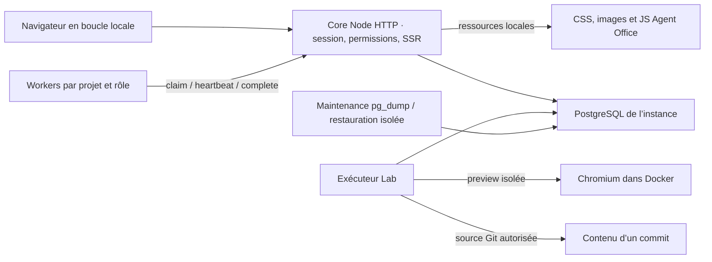

# Architecture observée et cible

Le même traitement HTTP produit HTML et API. Le worker poste des preuves sur le Core. La base persiste plans, attributions, baux, empreintes et événements. La présence combine les contacts A1 (20 secondes) et Control Room (30 secondes). Un bail vivant détermine l’occupation. Le JS du loft actualise un rendu serveur toutes les cinq secondes et associe un personnage au triplet projet, identifiant et rôle.

## Limites de confiance
Le navigateur utilise une session locale, une autorisation par projet et une vérification d’origine sur les commandes. Les clés runner sont distinctes des identités opérateur. La configuration hors Git, les vérificateurs de sauvegardes, les contrôles d’empreinte des migrations et les journaux PostgreSQL font partie du socle. Le lecteur est limité aux lectures. Les projets Git raccordés sont des sources de métadonnées. Chaque connexion à une autre base est une autorisation indépendante.

## Extensions
Conserver le serveur et la base existants. Introduire Academy avec progression et exercices privés synthétiques, un Explorer de métadonnées avec sources identifiées, une vue transversale des événements et un pilote graphique issu des mêmes baux. L’import de schéma ne doit jamais évaluer du SQL importé. Aucun changement de politique d’accès à la production n’est nécessaire pour la recette.
