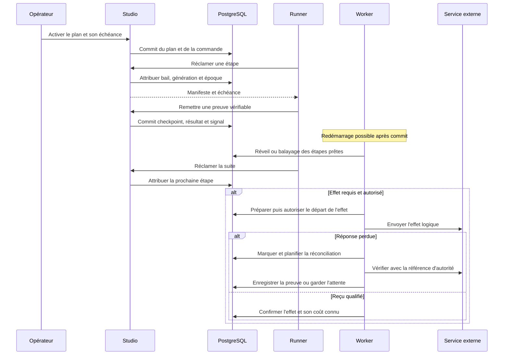

# Architecture d’autonomie et d’exécution

**Recommandation à valider · 25 novembre 2026**

Le Studio poursuivra une mission depuis PostgreSQL après une interruption. Le modèle ci-dessous précise les gardes manquantes dans le [dossier d’autonomie initial](../02-autonomie-et-agents.md) et l’[architecture des données](../01-architecture-et-donnees.md). Les seuils proposés sont des paramètres de recette. Les interfaces, durées d’arrêts et propriétés des services externes restent à qualifier dans [la recette](11-scenarios-de-recette-et-tests.md).

## 1. Construire et admettre une mission

| Phase | Décision et trace durable |
|---|---|
| Réception | Clé de commande, auteur ou déclencheur, projet, objectif, ressources et commit cible. Méthode d’obtention des données et livrable attendu |
| Qualification | Les capacités effectives résultent des politiques en vigueur et des contraintes du demandeur, projet, plan, rôle et runner. Une contrainte non satisfaite produit un motif précis. Les permissions ne proviennent jamais du libellé de tâche |
| Estimation | Le plan déclare nombre maximal de nœuds et d’appels, profil, échéance, preuves obligatoires et classe d’effets. Estimer temps actif, délai d’attente et dépense séparément. L’estimation ne réserve pas d’argent |
| Planification | Graphe acyclique, nœuds à identité logique stable, paramètres et sorties typés. Une dépendance dit quelle version de quelle preuve consommer. Le Studio valide les conditions de clôture |
| Activation | Plan immuable, politique et données par empreinte. Une décision humaine lie action, cible, commit, portée et échéance. La politique et les droits courants sont vérifiés à l’activation, à l’attribution et immédiatement avant un effet |
| Exécution | Attribution atomique, suivi par tentative, validation des preuves et contrôle indépendant. Une étape prête sans capacité en ligne conserve son motif |
| Finalisation | Rapport par projet, objectif, plan, cible, preuves, résultat de chaque contrôle, tentatives, coût constaté ou réservé et effets à suivre. Les décisions et contrôles obligatoires conditionnent le verdict |

**Niveaux d’autonomie.** A1 exécute automatiquement un plan fixé, y compris sans IA. A2 propose un plan à partir d’un objectif libre et attend son activation humaine. A3 révise les tâches futures dans une enveloppe déjà approuvée, avec comparaison de la version courante et nouvel accord humain si la destination des données, l’autorité, la portée ou un seuil change. La nouvelle révision conserve les compteurs et preuves de chaque lignée. À chaque plan fixer des plafonds de nœuds, tentatives, appels modèle et outils, durée active, échéance calendaire, parallélisme, propositions de révision et consommation. Les étapes de planification passent par ces mêmes plafonds. Les livrables rejetés et les révisions refusées comptent. Une conversation native reste un cache et le checkpoint Studio reste requis.

**Progrès.** Une étape progresse sur une preuve acceptée, une dépendance satisfaite ou une résolution de blocage. Un heartbeat et un message texte signalent une activité. Ils ne renouvellent pas la durée métier. Pour une lignée, comparer erreur, entrées et stratégie à la dernière tentative. Deux échecs équivalents peuvent suspendre avant la limite générale. Un délai de remise, une échéance d’attente, un budget et une durée active servent des usages différents et restent affichés distinctement.

## 2. Machines à états

Le **motif** est séparé de l’état. Par exemple, une étape reste prête quand le PC est indisponible après satisfaction des dépendances. Elle porte alors le motif « capacité hors ligne ». L’incertitude d’un effet ne se déduit jamais de la seule fin d’une tentative.

| Objet | États et transitions autorisées | Garde structurante |
|---|---|---|
| Mission | Reçue → qualifiée ou refusée. Qualifiée → en planification → à approuver ou prête. À approuver → prête ou en planification. Prête → en cours. En cours ↔ suspendue. Prête, en cours ou suspendue → arrêt demandé. En cours → réussie ou échouée. Arrêt demandé → annulée ou clôturée avec effet constaté | Une sortie terminale exige le règlement des tentatives actives et des effets nécessaires au verdict. Après la date butoir, interdire de nouveaux travaux métier tout en gardant la réconciliation utilisable |
| Étape | En attente → prête → en cours → réussie, échouée ou à réconcilier. Échouée → prête si reprise autorisée. À réconcilier → réussie si le résultat attendu est prouvé, échouée si le résultat ne convient pas, ou prête après preuve d’absence d’effet et nouvelle autorisation d’envoi. En attente → ignorée si parent obligatoire définitivement échoué. Prête → annulée. En cours → arrêt demandé → annulée après sortie du calcul et règlement des effets | Toute décision d’attribution se rapporte à un plan actif et à une version d’étape. Un résultat requis doit être vérifié avant d’activer l’aval |
| Tentative | Attribuée → démarrée → terminée, échouée ou arrêtée. Attribuée ou démarrée → bail perdu. Un état terminal reste historique | Une nouvelle exécution reçoit une nouvelle génération. L’arrêt physique peut être inconnu quand la tentative perd son bail |
| Effet | Préparé → départ engagé → confirmé ou incertain. Préparé → abandonné si aucun départ n’a été autorisé. Incertain → confirmé, absence établie ou attente d’arbitrage. Absence établie → préparé si l’autorisation actuelle permet la relance du même effet logique | La confirmation s’appuie sur une preuve distante ou un reçu durable qualifié. Une réponse intermédiaire peut signaler un traitement en file sans confirmer l’effet métier |

Le statut du runner combine présence et créneaux disponibles. La quarantaine d’un créneau empêche une nouvelle attribution de même portée tant que l’arrêt ou l’isolement du calcul précédent reste indémontré. Le statut fournisseur sépare débit limité, quota bloqué, panne et accès révoqué. Un retour à la disponibilité ne réactive aucun droit ou budget.

## 3. Écriture, concurrence et réconciliation

| Frontière | Contrat proposé |
|---|---|
| Commande | Une clé logique nommée dans sa portée et une empreinte de paramètres. Un rejeu de même empreinte rend l’état connu. Un contenu différent déclenche un conflit. L’application vérifie la version attendue |
| File | PostgreSQL possède les états métier. pg-boss planifie les réveils internes. Une transaction écrit résultat, checkpoint, événements et job ou signal persistant. La relance du job réévalue la précondition. Un balayage périodique récupère étapes éligibles et jobs perdus |
| Attribution | Verrouiller dans un ordre documenté les compteurs de capacité et l’étape. Vérifier l’éligibilité et l’unicité active puis attribuer génération, créneau, émission, horizon et époque de reprise. Une contrainte unique protège la tentative contrôlante par étape. Le tri d’admission ne constitue pas à lui seul une garantie d’équité |
| Renouvellement | Contrôler identité, projet, droits et génération avec l’horloge serveur. Réponse avec échéance de bail et consigne d’arrêt. Le superviseur compte localement depuis un instant conservateur et refuse de continuer après veille sans confirmation |
| Checkpoint | En unités métier, conserver cible, versions d’entrées, empreintes d’artefacts, référentiel, preuves validées et références d’effets. Finaliser la preuve et vérifier son empreinte avant le commit de progression. Les fichiers partiels restent jetables ou preuves non validées |
| Expédition externe | Persister intention unique, réservation et cible, puis autoriser le départ par génération. Fermer l’admission à la révocation. Une expédition déjà engagée peut produire un effet ultérieur. Garder cette distinction jusqu’à réconciliation |
| Réconciliation | Observer la source d’autorité par identifiant d’opération, reçu, commit ou référence de facturation. La preuve d’absence requiert une couverture, une fenêtre de visibilité et un contrat qualifiés. Une recherche vide ou un timeout reste inconclusif |

**Documenté, consulté le 25 novembre 2026.** PostgreSQL recommande la prudence avec la vue incohérente de `SKIP LOCKED`, adaptée à certaines files plutôt qu’à une lecture métier générale. L’insertion de jobs dans une transaction applicative est documentée par pg-boss. Tester les courses réelles avec deux connexions et deux workers sur la version choisie. Le commit SQL et l’effet réseau ne partagent pas de transaction. Temporal apporte la reprise des workflows et documente également l’idempotence des activités. Cette alternative ajoute une autorité d’historique et un service à exploiter. [Verrouillage PostgreSQL](https://www.postgresql.org/docs/current/sql-select.html), [isolation des transactions](https://www.postgresql.org/docs/current/transaction-iso.html), [pg-boss](https://github.com/timgit/pg-boss/blob/master/docs/api/adapters.md), [activités Temporal](https://docs.temporal.io/activity-definition)

### Séquence d’interruption et de reprise

## 4. Missions longues, déclenchements et pannes

Une mission longue garde un horizon unique et des délais par étape. Le réveil d’un plan de trente étapes peut être testé sous un profil de recette dédié, indépendamment du plafond plus étroit d’un pilote A2/A3. Le système ne maintient ni conversation ni verrou ouvert pendant une longue attente. Le retard de file, le délai de la dernière preuve et l’échéance totale restent mesurables.

Pour les missions récurrentes, écrire une occurrence logique unique par déclencheur et instant planifié normalisé. La version du déclencheur est auditée et les nouvelles versions partagent la clé logique d’une occurrence pour éviter le doublon. Au MVP conserver des cadences UTC. Après interruption, appliquer une politique explicite. Recommandation initiale pour les opérations de lecture récurrentes. Coalescer les occurrences échues vers la plus récente, consigner celles ignorées et interdire plus d’une instance active du même déclencheur. Un événement GitHub signé et persisté peut réveiller un traitement. Pour une mission créée sur changement de référence, construire la clé depuis la règle et la cible métier normalisée, en plus de la déduplication de livraison.

Priorité dans une même classe, puis tour des projets admissibles et vieillissement des demandes. La réservation d’un créneau est atomique. Un projet dont le runner est hors ligne ne retient pas le créneau d’un autre. Les accès exclusifs qui restent en quarantaine gardent leur propre portée. L’équité se mesure sur des missions simultanément éligibles avec une capacité effectivement disponible.

| Panne | Reprise automatique permise | Attente ou action humaine |
|---|---|---|
| Runner planté, PC éteint ou en veille | Calcul isolé, répétable et sans effet externe après perte de la génération, si le profil permet une nouvelle exécution | Accès exclusif ou arrêt indémontré, quarantaine. L’utilisateur voit le dernier checkpoint |
| Redémarrage worker/VPS | Reprendre les transactions commises, redéclencher les étapes prêtes et reprendre les baux valides sous preuve | Après restauration sur un autre hôte, changer d’époque, isoler l’ancien hôte et réconcilier les effets depuis le snapshot |
| PostgreSQL indisponible | Une fois revenu, relire état et événements. Récupérer les résultats ayant encore une génération valide | Aucun nouveau bail, engagement ou accusé durable pendant la panne. Les runners s’arrêtent selon leur délai local. Si une remise reste incertaine, la retrouver par clé |
| Fournisseur en panne ou quota atteint | Alternative qualifiée et autorisée à partir d’un checkpoint. Attendre le retour de capacité si la date et le coût le permettent | Contexte interdit, coût incertain ou effet en cours. [Failover et coûts](06-fournisseurs-et-strategie-failover.md) |
| Webhook perdu ou répété | Déduplication de livraison et réconciliation de l’état faisant autorité | Déclarer la projection périmée si l’état distant est indisponible |
| Date butoir dépassée ou annulation | Stopper les nouvelles attributions, terminer ou interrompre les calculs, garder la réconciliation | Effet irréversible déjà engagé ou non prouvable. Toute compensation possède sa propre autorisation |

## 5. Conditions de recette

La [recette](11-scenarios-de-recette-et-tests.md) doit couvrir la mission longue, le crash avant/après commit, deux workers et un même créneau, le départ réseau avant perte du reçu, la révocation avant départ, le PC en veille et le retour d’une ancienne génération. Laisser les compteurs et l’historique accessibles après chaque panne. Un test de simulation ne qualifie ni l’arrêt du superviseur réel, ni l’isolation PostgreSQL, ni la disponibilité d’une preuve distante.

**Arbitrages.** Horizon autorisé par classe, profils pouvant se réattribuer après échéance, règle de rattrapage des déclencheurs, preuves négatives admissibles par connecteur et possibilité de revoir un plan à l’approche de sa date butoir. La [coordination des agents](04-architecture-multi-agents.md), les [frontières de sécurité](07-security-threat-model.md) et le [déploiement](10-architecture-technique-et-deploiement.md) appliquent les mêmes identités de tentative et d’effet.
