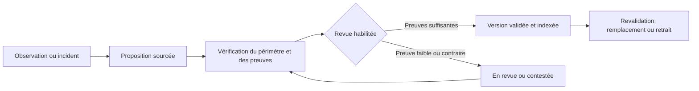

# Mémoire, apprentissage et contexte

**Recommandation à valider · 25 novembre 2026**

La mémoire du Studio relie chaque résultat aux versions, autorisations et preuves de la mission. Une connaissance utilisable a une provenance et un état de validation. Ce document complète le [dossier de mémoire initial](../03-memoire-et-apprentissage.md) par le contrat de publication, les règles de révocation en cascade et un protocole de choix de la recherche.

## 1. Niveaux et sources d’autorité

| Niveau | Contenu | Politique proposée |
|---|---|---|
| Tentative | Brouillon, cache, données de travail, état de session native | Court terme et isolé. La perte de la session ne rend pas une mission irrécupérable |
| Mission | Révisions du plan, entrées et preuves, erreurs, décisions et checkpoints | Registre durable du Studio. Un rapport historique conserve la version réellement utilisée |
| Agent | Profil, méthode, domaine et références aux leçons admises | Identité du Studio, indépendante du fournisseur. Les droits actuels de mission filtrent les références |
| Projet | Architecture, conventions, documentation, décisions et incidents | GitHub fait autorité sur le contenu versionné. Le Studio fait autorité sur événements et apprentissages approuvés |
| Studio | Modèles de mission, méthodes, politiques, synthèses transversales et observations fournisseur | Partage explicite. Les traces privées d’un projet restent sous ses autorisations |

Chaque projet conserve contenu et métadonnées sous sa propre portée. La mémoire d’un agent mutualisé est une vue de ses références autorisées, recalculée par mandat. L’export, le classeur et le moteur appliquent la même frontière. L’[architecture multi-agents](04-architecture-multi-agents.md) décrit les mandats.

## 2. Données, provenance et actualité

| Objet durable | Identité et champs structurants |
|---|---|
| Source | Projet, type, source d’autorité, identifiant du dépôt et commit avec chemin et plage, ou mission et tentative avec empreinte d’artefact |
| Énoncé de connaissance | Identifiant logique et révision, type, formulation normalisée, portée, versions applicables, auteur, date, classification, période de validité et statut |
| Relation de preuve | Source et révision, mode de collecte, résultat et confiance. Rôle de confirmation ou de contestation. L’identité du producteur de la preuve reste traçable |
| Événement éditorial | Acteur habilité, décision, date, version, motif, preuves et portée. Une correction crée une nouvelle version liée à la précédente |
| Contexte approuvé | Usage, plan et étape, sources et extraits, ordre, politiques, limites, destination et empreinte du lot |
| Transmission | Tentative, numéro de tour, adaptateur, destination, empreinte du contenu au point de sérialisation, règles de rétention et référence de l’autorisation appliquée |

Une preuve est valable dans son domaine. Un résultat observé sur une version précise reste vrai en tant qu’observation historique. Son utilisation sur une autre version nécessite un domaine d’application explicite. L’actualité tient compte du commit, de la version de dépendance, de la date de revalidation et des restrictions courantes. Une source récente ne contredit pas à elle seule une décision validée. Séparer l’état éditorial, la compatibilité technique et les accès.

Les index et caches sont reconstructibles. Les preuves et décisions sans autre source d’autorité font partie du point de sauvegarde. L’approche reprend les entités, activités et responsables du modèle de provenance W3C sans imposer un graphe ou une ontologie supplémentaire. **Documenté, consulté le 25 novembre 2026.** [W3C PROV-DM](https://www.w3.org/TR/prov-dm/), [données et sauvegardes du Studio](10-architecture-technique-et-deploiement.md)

## 3. Publier, contester et révoquer une leçon

1. **Proposer.** Un constat utile inclut objectif, comportement observé, preuve, hypothèse distincte, portée et limites. Un texte de modèle sans preuve reste une proposition. La duplication d’une réponse ne multiplie pas la preuve.
2. **Confronter.** Rechercher au sein du même périmètre les entrées actives et les preuves incompatibles. Dédupliquer les sources identiques. Préserver la causalité des preuves qui proviennent d’une même exécution. Deux résumés de la même source ne sont pas deux observations indépendantes.
3. **Vérifier.** Contrôler l’intégrité et la compatibilité des versions, puis faire reproduire un constat technique par le Quality Lab lorsque c’est possible. Le relecteur valide domaine de validité et limites. L’auteur peut soumettre des preuves et ne s’accorde pas la publication.
4. **Autoriser selon la sensibilité.** Une leçon de projet à faible impact peut être approuvée par le rôle de connaissance du projet. Une politique, un secret apparent ou une diffusion transversale remonte au rôle habilité. Une leçon ne donne aucun droit et ne change pas seule un contrôle. [Quality Lab](08-quality-lab-et-observabilite.md), [contrôles de sécurité](07-security-threat-model.md)
5. **Publier.** Version immuable exposée à la recherche. Une entrée contestée apparaît sous son statut dans la vue de revue et ne rejoint pas automatiquement un lot de contexte. Enregistrer les sources proposées mais ignorées et le motif.
6. **Maintenir.** Changement de dépendance, nouvelle contre-preuve, retrait de source ou échéance déclenche la revue. Un fait obsolète reste dans l’historique selon rétention. Un retrait de confidentialité ferme aussi l’accès au contenu historique selon la politique.

**Exemple conceptuel.** Une mise à jour de dépendance fait échouer un contrôle à un commit. La preuve porte le commit, la famille de versions, le référentiel et le résultat. Une seconde mission avec même version peut recevoir le constat. Une nouvelle version annonce la correction. Le Studio marque la leçon à revalider et arrête son injection automatique. Une reproduction indépendante décide si la nouvelle version résout le problème.

## 4. Récupération sélective et transmission

Le pipeline commence par les sources obligatoires et explicites. Valider appartenance, droit de lecture, classification et règles de destination. Restreindre les candidats avant de produire des extraits, scores, totaux et listes. Les résultats conservent chaque source, version et raison de sélection. Combiner exactitude, correspondance lexicale, provenance et compatibilité. Une connaissance contestée ou hors version reste exclue de l’usage automatique et visible selon les droits de revue.

Le lot affiche sources, passages, ordre, tokens estimés, contenu retiré et traitement ultérieur. Un opérateur autorisé peut exclure ou ajouter une source. Une référence indispensable écartée déclenche un blocage explicite. Avant chaque départ, recalculer la compatibilité avec la politique actuelle, le destinataire et l’adaptateur. L’approbation est liée à une version de lot. Une expansion du contexte, un changement de destinataire ou un nouveau périmètre peut la rendre caduque.

Pour une API directe, le registre associe chaque transmission à son lot et à l’empreinte des données effectivement sérialisées. Conserver une représentation chiffrée ou des références permettant une reconstruction déterministe selon la rétention. Enregistrer la troncature et les résultats d’outils ajoutés aux tours suivants. Exclure secrets d’authentification et accès implicites. Pour un CLI opaque, exposer les entrées observées et le reste non vérifié. Écarter ce moteur si la politique exige une inspection exhaustive. [Basculement et qualification](06-fournisseurs-et-strategie-failover.md)

### Révocation en cascade

Une révocation produit une version de politique et bloque les futures lectures et transmissions qui dépendaient de l’accès retiré. La vérification la plus récente est requise au départ. Un appel dont le départ est engagé reste réconciliable. La révocation ne retire pas des données déjà transmises. Arrêter les réemplois, invalider les caches et lots en attente, publier les index et dérivés corrigés, puis appliquer la purge prévue des extraits et vecteurs. Le cache doit intégrer le périmètre et la version de politique. Utiliser un événement de retrait pour réconcilier toute restauration avant réouverture. Pour empêcher une restauration ancienne de réintroduire une entrée interdite, conserver la politique ou les marqueurs de retrait postérieurs dans un registre de secours séparé lorsque la garantie est requise. À défaut de registre fiable, laisser la recherche et les nouveaux envois fermés jusqu’à décision.

Les dérivés héritent des restrictions maximales pertinentes de leurs sources. Une promotion globale exige un nouvel examen et une représentation explicitement expurgée. Le lien de provenance privée peut rester sous accès restreint et n’est pas exposé avec le contenu partagé. Lorsque légitimité et conservation diffèrent, retenir un marqueur ou une empreinte avec un statut « contenu retiré » si la politique l’autorise. L’accès aux index de recherche ne donne aucun droit supplémentaire. **Documenté, consulté le 25 novembre 2026.** La RLS PostgreSQL comporte des exemptions pour le propriétaire de table et les rôles privilégiés. Tester les identités de service et ne pas dépendre de la seule RLS pour les documents ou artefacts hors base. [PostgreSQL RLS](https://www.postgresql.org/docs/current/ddl-rowsecurity.html)

## 5. Choix de la recherche

| Solution | Apport et risque | Recommandation |
|---|---|---|
| Recherche lexicale PostgreSQL | Index GIN pour le texte, correspondances explicables des termes et identifiants. Lemmatisation et synonymes exigent du réglage | MVP avec champs titres, symboles, chemins, versions et contenu |
| Lexicale et re-classement déterministe | Rehausse sources officielles, commit exact et fraîcheur. Une pondération excessive de la date peut écarter la décision pertinente | MVP sous recette. Le score et les critères sont explicables |
| Hybride avec pgvector | Combine sens et exactitude. Embeddings, protection des données, versions de modèle et dérivés à gérer | Piloter sur corpus autorisé. Commencer par recherche exacte filtrée. Si ANN devient nécessaire, mesurer le rappel après filtrage |
| Base vectorielle séparée | Peut découpler un volume et des charges confirmés. Ajoute service, cohérence, ACL, rétention et restaurations | Attendre un besoin constaté. La recherche ne change pas l’autorité de publication |

**Documenté, consulté le 25 novembre 2026.** PostgreSQL recommande GIN pour la recherche sur un `tsvector`. pgvector documente la recherche exacte et approximative ainsi que les interactions entre filtres et index approximatifs. L’extension seule ne fournit ni politiques ni métrique de pertinence propre au projet. [PostgreSQL, index de recherche](https://www.postgresql.org/docs/current/textsearch-indexes.html), [pgvector](https://github.com/pgvector/pgvector)

**Protocole de décision proposé.** Réunir au moins 30 requêtes représentatives annotées avant réglage, dont des cas de symboles exacts, paraphrases, versions incompatibles et accès retirés. Sur le même corpus, mesurer le rappel des sources attendues dans les cinq premières positions, la citation du bon commit, la latence p95, la dérive par version et le coût d’indexation. Séparer sous-ensembles d’ajustement et de mesure. Exiger zéro résultat interdit, y compris par extrait ou total. Comparer le classement hybride au lexical avant activation. Seuil indicatif issu du dossier initial, à confirmer sur l’échantillon. Gain de 15 points de rappel sur les requêtes reformulées et aucune régression déclarée sur les identifiants exacts. Les mesures du corpus réel restent à conduire.

## 6. Recette et décisions

| Scénario | Invariant attendu |
|---|---|
| Une leçon sans source et une leçon contestée existent | Les deux restent inspectables sous droits. Aucune injection automatique |
| Une source fournit deux synthèses équivalentes | Une seule provenance directe, et aucune illusion de confirmation indépendante |
| Retrait entre assemblage et transport | L’admission bloque le nouvel appel. Si le départ était engagé, l’état reste explicite |
| Sauvegarde antérieure à un retrait | Recherche fermée jusqu’à application des événements ou politiques de retrait disponibles |
| Deux projets partagent un profil | Aucun extrait, titre, compteur ou fragment privé croisé |
| Agent passe d’un CLI opaque à une API directe | Identité et lot durable conservés. Nouveaux droits et inspection réévalués |
| Index hybride sous filtre étroit | Rappel et latence mesurés après filtre. Aucun document hors autorisation |

**À valider.** Niveau de validation par classe d’apprentissage, portée commune, rétention de preuves et des lots, maintien indépendant des marqueurs de retrait, et seuils du pilote hybride. Les protections et l’évaluation nécessitent une [recette d’intégration](11-scenarios-de-recette-et-tests.md) sur données autorisées.
