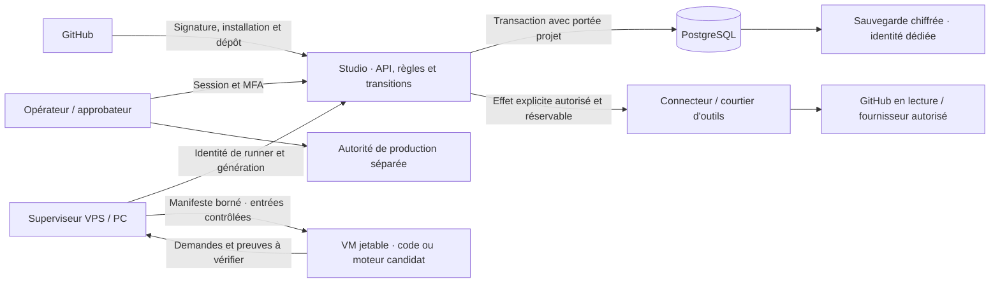

# 07 — Modèle de menaces, permissions et isolation

**Revue approfondie proposée · 25 novembre 2026 · Axes G1–G4**

Cette révision transforme les protections du [dossier de sécurité](../07-securite-runners-et-resilience.md) en contrats de contrôle et de recette. Le principal écart est l'intervalle entre décision, bail et effet réel. Le Studio peut retirer un pouvoir qu'il détient encore. Une mutation déjà partie vers un service externe peut rester incertaine malgré une révocation ou l'arrêt de la VM. Le modèle distingue donc admission, autorisation d'envoi, accusé distant et confirmation de résultat. Les mesures ci-dessous sont proposées et restent à qualifier sur les installations réelles.

## Actifs et frontières de confiance

Les actifs prioritaires sont les données inter-projets, les sources et preuves, les identités humaines et techniques, les clés de fournisseurs, l'argent engagé, le journal d'audit, les intentions d'effets, les sauvegardes et les pouvoirs de production. Un artefact, document, ticket, journal de runner ou résultat de modèle est une donnée susceptible d'être erronée, même si sa source est authentifiée.

Le Studio est l'autorité de politique. Le superviseur de runner est une autorité limitée pour attester le cycle de vie local. Le moteur et la VM n'acquièrent aucune autorité en émettant une demande. Les deux processus Studio et worker partagent un hôte et dépendent de PostgreSQL. Cette topologie ne contient pas une compromission de l'administrateur du VPS. Le contrôle explicite d'identité, de ressource et d'action suit les principes documentés de contrôle d'accès par ressource. Documentation consultée le 25 novembre 2026. [NIST SP 800-207](https://csrc.nist.gov/pubs/sp/800/207/final)

## Décision de permission

Pour un acte proposé, le Studio met en intersection les autorisations courantes de l'utilisateur ou du principal technique initiateur, du projet, de la politique Studio, du plan, de la classe de données, de l'agent, du moteur et du runner. Un refus explicite, une portée inconnue, une révocation, une approbation absente ou une capacité non qualifiée refusent l'acte. Une mission planifiée possède une identité technique à portée propre, une échéance et un responsable. La disparition des droits de ce responsable ou de la délégation suspend la suite selon la politique du projet. Une nouvelle version de politique peut invalider une décision précédente. Aucun composant ne complète un droit manquant à partir d'un autre projet ou d'un autre acteur.

| Famille | Granularité | Autorité proposée pour le MVP |
|---|---|---|
| Lire | Projet, type d'objet, version, classification, destination. Export, prompt et recherche ont leurs propres portées | Membre habilité et filtrage de chaque objet. Accès technique restreint au travail confié |
| Écrire | Brouillon, actualisation d'état, artefact, configuration, contenu GitHub | L'agent peut remettre un candidat borné. Le Studio contrôle l'état et les références. GitHub en lecture seule |
| Exécuter | Catalogue, contrôle versionné, entrée, durée, concurrence, réseau, profil de confiance | Le Studio attribue, le superviseur impose. Une commande arbitraire issue d'un document n'est pas un outil autorisé |
| Déployer | Commit ou image, environnement cible, identité approbatrice, règle de la chaîne recevant l'effet | Aucun pouvoir de production détenu par le runner ou le Studio au MVP. Procédure humaine externe à démontrer |
| Supprimer | Objet, projet, motif, rétention et irréversibilité | Hors outils d'agents. Décision humaine selon portée et politique de conservation |
| Accéder à un secret | Référence, finalité, destinataire, échéance et possibilité de rotation | Le connecteur légitime résout la référence. Les données brutes n'entrent ni dans le contexte, ni dans un processus candidat. Administration protégée |
| Accéder à un service externe | Service, opération, destination, identifiants dédiés, volume et borne de coût | Courtier hors VM. Deux règles indépendantes couvrent la transmission et la dépense. Sortie directe seulement pour un profil qualifié et dont la politique l'autorise |
| Modifier la configuration | Ressource, version précédente, version candidate et pouvoir affecté | Exploitant ou gestionnaire habilité, réauthentification et audit. Aucun outil d'agent ne modifie son propre profil |

**Action sensible future.** Figer projet, cible et environnement, empreinte du plan et de l'objet à modifier, données sortantes, borne de dépense, expiration et acteur. Vérifier l'approbateur courant, la séparation définie pour l'action, l'identité du connecteur et la dernière génération autorisée juste avant envoi. Enregistrer l'intention et consommer la décision de façon atomique. L'approbation est liée à une seule intention logique et ne permet aucune répétition arbitraire. Si la sortie est déjà passée, une révocation stoppe les envois suivants et signale la réconciliation. Une révocation du Studio ne rétroagit pas sur une opération dont le service distant a pris possession. La preuve de contrôle de production doit venir de son autorité effective.

**Données du projet.** Les références composites interdisent les liens accidentels entre projets. Les requêtes, téléchargements et recherches portent une portée transactionnelle validée. Le rôle applicatif ne doit pas posséder les tables protégées ni disposer de droits contournant la RLS. Vérifier le pool après erreur et après changement de projet. Les opérateurs de sauvegarde et migration disposent de droits séparés avec accès restreint. Une suppression d'accès invalide les nouveaux téléchargements, extraits et transmissions. Les demandes historiques demeurent visibles uniquement aux personnes encore autorisées. Les politiques PostgreSQL documentent l'exception de propriétaire de table et les vérifications d'intégrité référentielle. Documentation consultée le 25 novembre 2026. [RLS PostgreSQL](https://www.postgresql.org/docs/current/ddl-rowsecurity.html)

## Runners et limites d'isolation

| Objet | Runner VPS | Runner PC |
|---|---|---|
| Usage | Entrées bornées, opérations de confiance, indexation et tâches déterministes passives | Compilation, tests, moteurs locaux et code candidat dans un périmètre jetable |
| Frontière | Même hôte que le contrôle et la base. Aucun candidat exécutable ni moteur opaque | Superviseur de confiance séparé de la VM. Pas de montage d'identités, de volumes personnels ou de socket hôte dans l'environnement candidat |
| Réseau | Ne publie aucune API libre à destination du candidat | Polling HTTPS sortant et authentifié. Le réseau de la VM est fermé par défaut, avec accès limité pour un profil expressément qualifié |
| Disponibilité | Peut poursuivre des travaux compatibles pendant l'arrêt du PC | L'absence de capacité ne crée pas de tentative. Les travaux attendent jusqu'à leur échéance |
| Récupération | Nouvelle tentative seulement avec catégorie de reprise admise | Contrôle de l'époque et du bail au réveil. Détruire l'environnement ou maintenir une quarantaine si l'arrêt est impossible à attester |

**Arbitrage.** Un conteneur rootless facilite la reproductibilité pour les tâches de confiance et limite certains privilèges. Une VM apporte une frontière de noyau plus forte, au coût d'une consommation mémoire et d'une qualification sur l'OS réel. Un runner tiers ajoute un nouvel opérateur, une politique de données, des clés et une facturation possibles. Pour le MVP, retenir un VPS de confiance et une VM PC pour l'exécution du code candidat. Une VM ne dispense pas de la restriction réseau, de la validation des artefacts et de l'isolation du superviseur. Documentation consultée le 25 novembre 2026. [Docker rootless](https://docs.docker.com/engine/security/rootless/), [isolation par VM dans Docker Desktop Linux](https://docs.docker.com/desktop/troubleshoot-and-support/faqs/linuxfaqs/)

**Protocole de contrôle.** Enrôlement à usage unique autorisé par un exploitant. Identité spécifique à un runner, rotation et révocation distinctes de la session humaine. Le superviseur garde le secret hors VM et présente le projet, le créneau, la tentative et sa génération. Une limite locale conservatrice impose l'arrêt assez tôt pour tenir compte de la perte du réseau. Une mise en veille ou un changement d'époque empêche la reprise du candidat avant réévaluation. Si l'appareil ne peut démontrer l'arrêt, bloquer les créneaux et ressources susceptibles d'être encore utilisés. Une relance isolée évaluée comme répétable peut changer de créneau. Les preuves de fin tardives sont des observations, sans pouvoir de mutation sur une génération réattribuée.

**Chaîne d'approvisionnement.** Épingler les images et fichiers de verrouillage des dépendances. L'approbation d'une nouvelle image porte sa provenance et son empreinte. Les dépôts de confiance sont définis par politique. Les caches sont séparés par classe de confiance et invalidés lors d'un incident. Les téléchargements d'artefacts contrôlent taille, empreinte, nature et autorisation à chaque lecture. L'approbation d'une dépendance n'accorde ni accès réseau illimité ni droit d'écriture extérieur.

## Menaces et preuves d'acceptation

Les scénarios utilisent des fixtures, des identités de test et des destinations synthétiques. La recette vérifie les refus et les traces. Aucun accès, secret ou système de production n'est nécessaire.

| Menace et cible | Contrôle de prévention | Preuve défensive à demander | Limite résiduelle |
|---|---|---|---|
| Accès inter-projets ou ID réutilisé | Vérification explicite, RLS, références composites et cache par identité | Un lecteur et un runner limités à P1 n'obtiennent aucune ressource, compteur, extrait ni artefact P2. Vérifier aussi URL ancienne et export | Une erreur dans un rôle privilégié reste possible. Tester les chemins de support et de restauration |
| Instructions non fiables dans document, ticket ou résultat | Interprétation comme donnée. L'autorité de destination et d'outil est hors du moteur | Une instruction synthétique demande un outil hors plan. Le courtier refuse et la décision n'augmente ni droit ni budget | Le moteur peut encore produire un livrable faux ou incomplet |
| Secret présent dans un document ou un journal | Classification et contrôle à la remise puis à la transmission. Métadonnées filtrées | Insérer un marqueur non secret qualifié comme donnée protégée. Il reste exclu des prompts, traces et notifications non autorisés | Un détecteur peut manquer une donnée atypique. Privilégier les sources explicitement autorisées |
| Code candidat ou image compromise | VM isolée, pas de privilège hôte, limites, provenance et flux sortants bornés | Une tâche de test ne voit que ses entrées et ne dispose pas de l'identité du superviseur. L'arrêt termine l'environnement dans l'enveloppe autorisée | Défaut d'hyperviseur ou superviseur compromis. Preuves critiques à corroborer ailleurs |
| Runner volé ou révoqué | Identité rotative, portées et génération courante | Une révocation interdit l'attribution, le renouvellement et le dépôt d'une preuve active. Vérifier les observations tardives | Restreindre et rapprocher les actions déjà parties. La perte locale de confiance peut imposer une réexécution |
| Politique ou approbation contournée | Empreinte de cible et de plan, contrôle courant, décision unique | Une modification du commit ou de la destination invalide l'approbation. L'agent ne peut ni la fabriquer ni la réutiliser | Une CI externe peut avoir un chemin indépendant. Inventorier les autorisations réelles |
| Webhook GitHub altéré ou rejoué | Signature sur corps brut, installation et dépôt autorisés, déduplication, convergence | Valider source et portée pour chaque livraison. Doublons et désordre conduisent au même état projet et à un seul effet logique | Un événement signé valide peut être ancien. L'état courant s'établit par réconciliation |
| Consommation répétée après timeout | Réservation, clé logique, preuve distante et suspension en cas d'incertitude | L'effet reste en rapprochement et conserve la réservation lorsqu'un accusé manque. Aucune répétition aveugle | Le service distant peut ne fournir aucune preuve concluante |
| Altération d'audit et sauvegarde | Rôles d'écriture restreints, extraits minimisés hors hôte, sauvegarde chiffrée externe | Restaurer sur un hôte de test vierge, vérifier manifestes et rôles, rapprocher effets depuis le point restauré | Une identité privilégiée et une cible SFTP modifiable restent des points de compromission à couvrir |

Les guides confirment les mécanismes de signature et catégories d'injection documentés. Ils ne démontrent pas les protections effectives du Studio. Documentation consultée le 25 novembre 2026. [GitHub, validation des livraisons](https://docs.github.com/en/webhooks/using-webhooks/validating-webhook-deliveries), [GitHub, ordre et diagnostic](https://docs.github.com/en/webhooks/testing-and-troubleshooting-webhooks/troubleshooting-webhooks), [OWASP, injection d'instructions](https://genai.owasp.org/llm2026/llm012026-prompt-injection/)

## Décisions et dépendances

Le MVP peut fonctionner sans fournisseur externe et sans accès écrit à GitHub. L'autorité réceptrice de production, le niveau d'attestation qualité, les profils réseau, les règles de séparation des approbateurs et la procédure de secours nécessitent validation du propriétaire. Les baux et effets sont détaillés dans [l'architecture d'autonomie](03-architecture-autonomie-et-execution.md). La confiance des preuves et la supervision sont précisées dans [Quality Lab et observabilité](08-quality-lab-et-observabilite.md).
