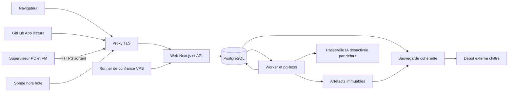

# Architecture technique et déploiement

**25 novembre 2026 · conception.** Sources officielles consultées le 25 novembre 2026. Aucune version ni installation n'a été qualifiée sur le VPS cible. Le système est multi-projet pour un même propriétaire, avec isolation logique, sans promesse de haute disponibilité.

## Choix techniques et seuils de remplacement

| Composant | Recommandation, coût marginal et limite | Alternative et signal de réexamen |
|---|---|---|
| Web | Next.js TypeScript auto-hébergé derrière proxy. Un déploiement unique simplifie versions et cookies. Éviter cache privé partagé et chemins dépendants de Vercel | Fastify + interface séparée si surface API et cycle de livraison deviennent indépendants. Remplacement par contrat HTTP et routes versionnées |
| Base | PostgreSQL porte état, réservations, contrôles d'appartenance et recherche. Pas de service de file supplémentaire. RLS en défense additionnelle avec rôles appropriés | SQLite utile aux simulations. PostgreSQL managé seulement si restauration, contournement de point de panne ou exploitation le justifient |
| Queue et worker | pg-boss pour réveils, relances bornées et cadence. Transaction intégrée à qualifier. PostgreSQL saturé affecte la file et l'API | Table d'envoi et balayage si intégration transactionnelle fragile. Temporal si la maintenance des workflows et la charge le démontrent. Les effets externes restent idempotents dans tous les cas |
| Sessions et MFA | Better Auth et TOTP, configuration testée par voie de connexion, récupération exercée, identités techniques séparées | IdP autonome si besoins d'entreprise. Passkeys après preuve de récupération et compatibilité du domaine |
| Déploiement | Compose pour web, worker, proxy et datastore. Image versionnée, profils distincts et sonde externe | Gestion par services système si environnement plus simple. Pas de Kubernetes avant besoin de plusieurs hôtes et équipe d'exploitation |
| Runners | HTTPS sortant, polling et lot d'événements. API vérifie bail, identité et profil. VM PC jetable pour code candidat | Canal poussant les événements si latence observée le justifie. CI externe sous qualification et coûts séparés |
| Recherche | PostgreSQL FTS et filtres par projet en premier. Évaluer trigrammes puis hybride sur corpus annoté | pgvector si rappel insuffisant et réindexation sûre. Base vectorielle séparée uniquement pour un besoin mesuré |
| Artefacts et sauvegardes | Volume local par identifiant immuable et Restic chiffré sur SFTP. Tenir un inventaire des objets référencés | Borg si support et expertise établis. Stockage objet en cas de volume, concurrence ou durée de restauration excessive |

[Next.js](https://nextjs.org/docs/app/guides/self-hosting), [pg-boss](https://github.com/timgit/pg-boss/blob/master/docs/api/adapters.md), [Temporal](https://docs.temporal.io/activities), [RLS](https://www.postgresql.org/docs/current/ddl-rowsecurity.html), [Better Auth MFA](https://better-auth.com/docs/plugins/2fa), [Restic](https://restic.readthedocs.io/en/stable/030_preparing_a_new_repo.html)

## Contrats de persistance

| Agrégat | Contraintes et index critiques |
|---|---|
| Projet, appartenance, installation | Clés composites projet/ressource. Appartenance unique. Politique d'effet et budget propres au projet. Catalogue global de capacités sans accès aux données privées |
| Mission, plan, étape, arête | Plan et empreinte immuables après activation. Une révision active. Arêtes de la même version, validation d'acyclicité, index sur travail prêt et date de réveil |
| Tentative, créneau, checkpoint | Attribution transactionnelle, génération par tentative et époque après restauration. Partiel unique pour tentative contrôlante. Index des échéances |
| Effet et usage | Clé stable par intention et payload approuvé, statut de réconciliation, référence distante. Réservations sur fenêtres global, projet, mission et agent. Index de rapprochement et contraintes de numéraire |
| Source, paquet, artefact et rapport | Version, hash et droits par projet. Manifeste sans chemin hôte, vérification après téléchargement. Rétention des références et preuves |
| Événements, projections et notifications | Séquence par agrégat et événement unique pour chaque cause stable. Projection reconstruisible, curseur et signal de fraîcheur. Pas d'event sourcing exhaustif au MVP |

**API internes.** Les commandes humaines emploient clé de commande et version attendue. API runner pour enrôlement, présence, demande de travail, renouvellement, événements et remise. API webhook valide signature avant commit. Une réponse réussie à une commande signifie transition durable. Les preuves tardives sont des observations, avec interdiction de modifier le verdict courant. Un contrat reconfiguré impose de requalifier ses appels.

**Projets multiples.** L'identité du dépôt ne sert jamais de frontière d'autorisation unique. Chaque opération vérifie projet, installation, dépôt et permission courante. Les ressources mutualisées possèdent des droits projet distincts. Les poids et plafonds de capacité se calculent par projet admissible. La configuration Folk & Joy instancie les mêmes profils qu'un deuxième dépôt synthétique.

## Chemin GitHub progressif

| Niveau | Autorité et preuve |
|---|---|
| G0 MVP | GitHub App lecture de commits, branches, issues et PR sur installations choisies. Dédupliquer les livraisons, acquitter après commit et réparer les absences par lecture paginée |
| G1 Local | Préparer et modifier un candidat sur copie isolée. Tests et patch exportable. Aucun droit GitHub d'écriture requis |
| G2 Écriture optionnelle | Identité distincte, autorisation d'effet liée au dépôt, branche, candidat et tête attendue. Publication de branche/commit et PR brouillon sous registre d'effets. Confirmer l'état distant en cas d'échec ambigu |
| G3 Réception et production | Merge humain et déploiement sous approbation de la chaîne réceptrice. Contrôler protections, forfait et identifiants effectifs avant d'afficher « imposé » |

L'installation vérifie le lien entre dépôt et installation sur chaque événement. Limiter taille, persister empreinte et livraison, relire état en cas d'inversion, utiliser des curseurs par ressource. Fenêtre d'incrément chevauchante et resynchronisation complète bornée. Un accès révoqué est différent d'une vue simplement périmée. [Webhooks](https://docs.github.com/en/webhooks/using-webhooks/best-practices-for-using-webhooks), [environnements GitHub](https://docs.github.com/en/actions/how-tos/deploy/configure-and-manage-deployments/manage-environments)

## Exploitation et changement de versions

Déployer uniquement après validation distincte. Privilégier changements compatibles entre web et worker, séparation rôle de migration et rôle courant, sauvegarde vérifiée avant changement de schéma et vérification de rollback. Versionner schémas de commandes et d'événements, modèles de missions, format d'export et références de preuves. Seuil initial indicatif de deux utilisateurs, deux runners et sauvegarde concurrente. Les artefacts et volumes sont dimensionnés sur les essais du [budget](12-budget-et-scenarios-economiques.md).

Deux captures visées par jour, dépôt externe chiffré. Accès de secours conservés hors hôte. Une sauvegarde combine dump cohérent et manifeste d'artefacts immuables. RPO ≤24 h mesuré par âge du point exploitable, RTO lecture ≤4 h sur hôte vierge. Reprise des effets mesurée séparément après isolation de l'ancien hôte et rapprochement des opérations et dépenses. Le contrôle de purge respecte les objets référencés par les captures. Tester suppression, indisponibilité du stockage et reconstruction sans fournisseur IA selon [11](11-scenarios-de-recette-et-tests.md).
